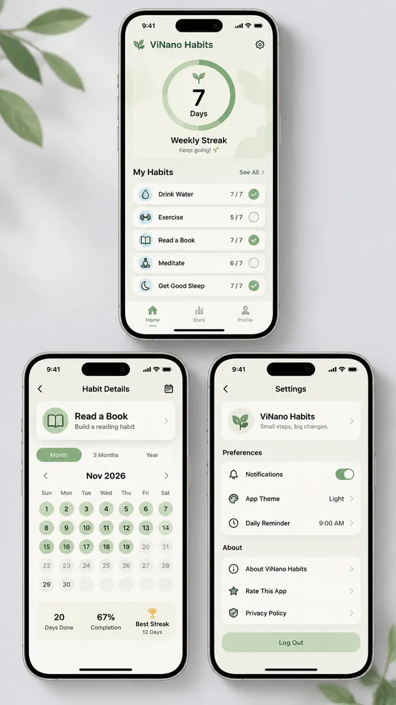

# Habit Tracker App Screens

[← Back to the collection](../../README.md) · Category: [UI & Graphic](../../gallery/ui-graphic.md) · Model: `GPT Image 2.6 Flare` · ID: `vn-02141`

<a href="https://vinano.ai?utm_source=github&utm_medium=readme&utm_campaign=awesome-image-video-prompts-updating&utm_content=prompt-page-image"></a>

<sub>Preview generated with <a href="https://vinano.ai?utm_source=github&utm_medium=readme&utm_campaign=awesome-image-video-prompts-updating&utm_content=prompt-page-caption">vinano.ai</a> · added 2026-11-19</sub>

## Prompt

```text
Three mobile app screens side by side for a calm habit tracker app called "ViNano Habits": a home screen with a weekly streak ring and five habit cards, a detail screen with a monthly heatmap calendar, and a settings screen with soft toggles. Light sage-green and cream color scheme, rounded 24px cards, friendly sans-serif type, subtle drop shadows, realistic iPhone-style frames on a pale gray background, crisp readable UI text.
```

## Try it on vinano.ai

1. Copy the prompt above.
2. Open **[vinano.ai](https://vinano.ai?utm_source=github&utm_medium=readme&utm_campaign=awesome-image-video-prompts-updating&utm_content=prompt-page-try)**, paste it into the image generator and pick a model.
3. Swap any placeholders (brand, product, city, person…) for your own details, then generate.

More prompts like this: [UI & Graphic gallery](../../gallery/ui-graphic.md) · [all categories](../../README.md#contents)
