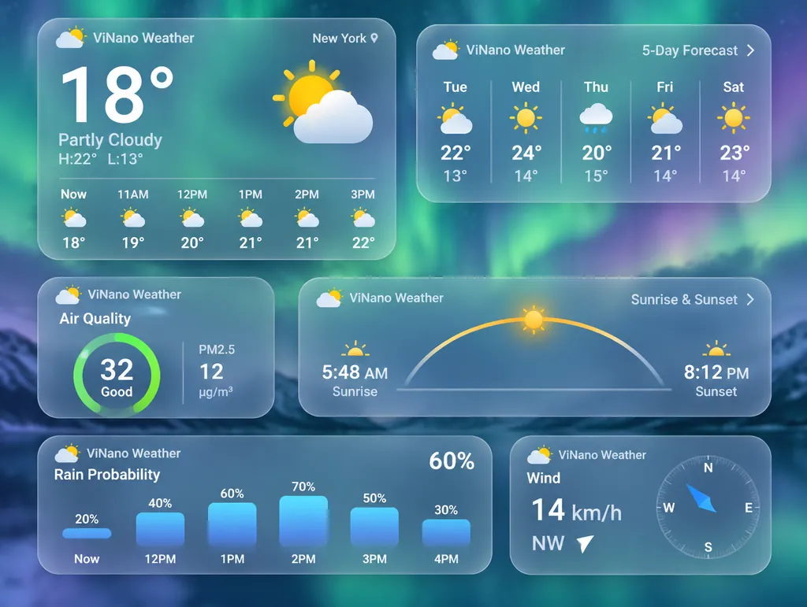

# Glassmorphism Weather Widgets

[← Back to the collection](../../README.md) · Category: [UI & Graphic](../../gallery/ui-graphic.md) · Model: `GPT Image 2.6 Flare` · ID: `vn-02152`

<a href="https://vinano.ai?utm_source=github&utm_medium=readme&utm_campaign=awesome-image-video-prompts-updating&utm_content=prompt-page-image"></a>

<sub>Preview generated with <a href="https://vinano.ai?utm_source=github&utm_medium=readme&utm_campaign=awesome-image-video-prompts-updating&utm_content=prompt-page-caption">vinano.ai</a> · added 2026-11-23</sub>

## Prompt

```text
A set of six home-screen weather widgets for an app named "ViNano Weather", arranged on a soft blurred aurora-colored wallpaper: a large widget with current temperature 18°, partly cloudy icon and hourly forecast strip, a medium 5-day forecast widget, a small air-quality ring, a sunrise/sunset arc, a rain probability bar chart and a wind compass. Frosted glass cards with subtle borders, rounded corners, clean SF-style typography, crisp readable numbers, consistent icon set.
```

## Try it on vinano.ai

1. Copy the prompt above.
2. Open **[vinano.ai](https://vinano.ai?utm_source=github&utm_medium=readme&utm_campaign=awesome-image-video-prompts-updating&utm_content=prompt-page-try)**, paste it into the image generator and pick a model.
3. Swap any placeholders (brand, product, city, person…) for your own details, then generate.

More prompts like this: [UI & Graphic gallery](../../gallery/ui-graphic.md) · [all categories](../../README.md#contents)
