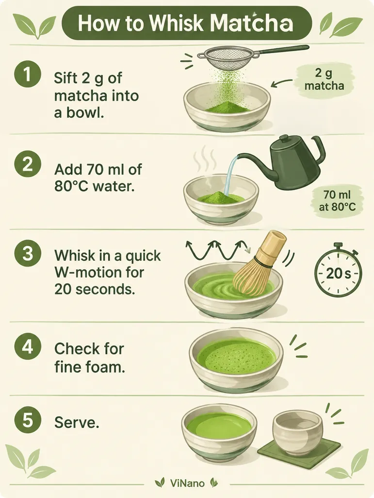

# Matcha Brewing Step Guide

[← Back to the collection](../../README.md) · Category: [UI & Graphic](../../gallery/ui-graphic.md) · Model: `GPT Image 2.6 Flare` · ID: `vn-02153`

<a href="https://vinano.ai?utm_source=github&utm_medium=readme&utm_campaign=awesome-image-video-prompts-updating&utm_content=prompt-page-image"></a>

<sub>Preview generated with <a href="https://vinano.ai?utm_source=github&utm_medium=readme&utm_campaign=awesome-image-video-prompts-updating&utm_content=prompt-page-caption">vinano.ai</a> · added 2026-11-23</sub>

## Prompt

```text
An illustrated step-by-step guide titled "How to Whisk Matcha" laid out as a vertical recipe card with five numbered steps: sift 2 g of matcha into a bowl, add 70 ml of 80°C water, whisk in a quick W-motion for 20 seconds, check for fine foam, serve. Each step has a small flat vector illustration of the bamboo whisk, bowl and kettle, short captions in clean sans-serif, soft matcha green and cream palette, thin dividers, a tiny "ViNano" footer.
```

## Try it on vinano.ai

1. Copy the prompt above.
2. Open **[vinano.ai](https://vinano.ai?utm_source=github&utm_medium=readme&utm_campaign=awesome-image-video-prompts-updating&utm_content=prompt-page-try)**, paste it into the image generator and pick a model.
3. Swap any placeholders (brand, product, city, person…) for your own details, then generate.

More prompts like this: [UI & Graphic gallery](../../gallery/ui-graphic.md) · [all categories](../../README.md#contents)
