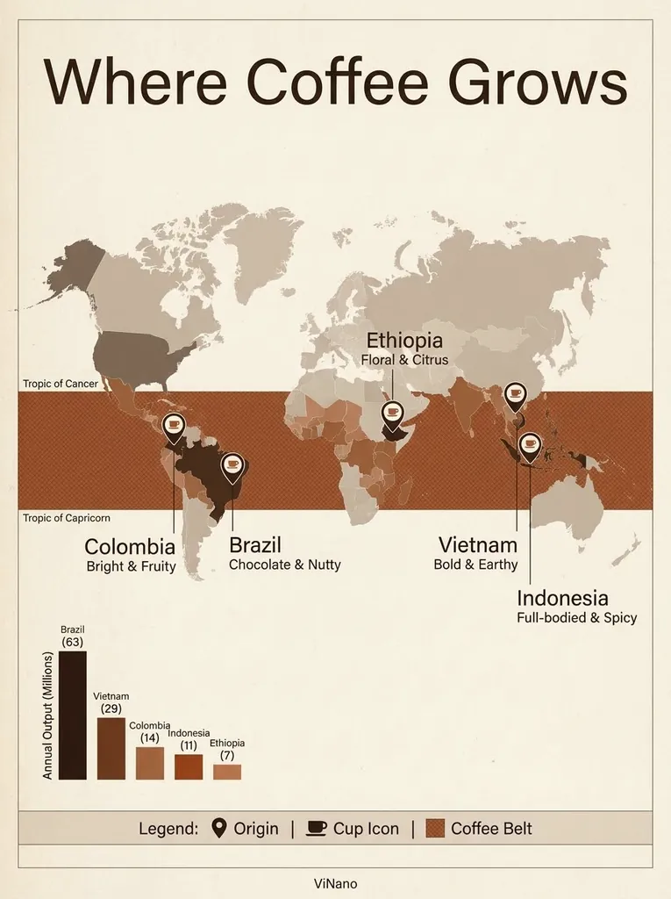

# Coffee Origins Infographic Map

[← Back to the collection](../../README.md) · Category: [UI & Graphic](../../gallery/ui-graphic.md) · Model: `Nano Banana Pro` · ID: `vn-02161`

<a href="https://vinano.ai?utm_source=github&utm_medium=readme&utm_campaign=awesome-image-video-prompts-updating&utm_content=prompt-page-image"></a>

<sub>Preview generated with <a href="https://vinano.ai?utm_source=github&utm_medium=readme&utm_campaign=awesome-image-video-prompts-updating&utm_content=prompt-page-caption">vinano.ai</a> · added 2026-11-24</sub>

## Prompt

```text
An editorial infographic poster titled "Where Coffee Grows": a stylized flat world map with the coffee belt between the tropics shaded in warm brown, five labeled origin pins (Ethiopia, Colombia, Brazil, Vietnam, Indonesia) each with a tiny cup icon and a one-line flavor note such as "floral & citrus" or "chocolate & nutty". A small bar chart in the corner compares annual output, a legend strip runs along the bottom, clean geometric sans-serif labels, cream paper background, espresso and terracotta palette, a small "ViNano" footer credit.
```

## Try it on vinano.ai

1. Copy the prompt above.
2. Open **[vinano.ai](https://vinano.ai?utm_source=github&utm_medium=readme&utm_campaign=awesome-image-video-prompts-updating&utm_content=prompt-page-try)**, paste it into the image generator and pick a model.
3. Swap any placeholders (brand, product, city, person…) for your own details, then generate.

More prompts like this: [UI & Graphic gallery](../../gallery/ui-graphic.md) · [all categories](../../README.md#contents)
