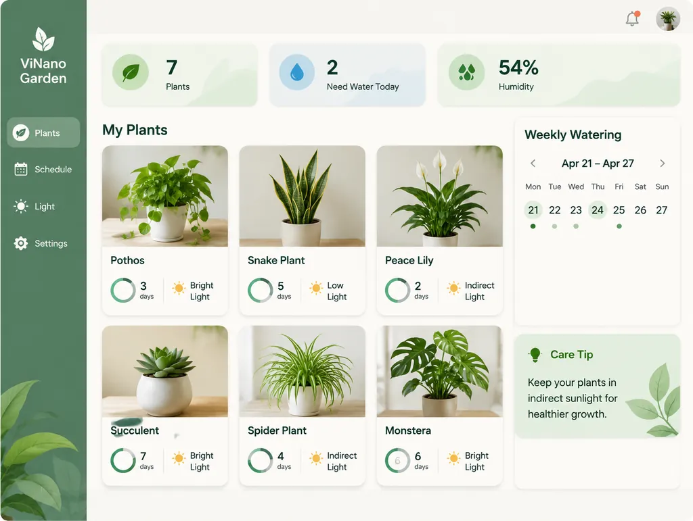

# Plant Care App Dashboard

[← Back to the collection](../../README.md) · Category: [UI & Graphic](../../gallery/ui-graphic.md) · Model: `GPT Image 2.6 Flare` · ID: `vn-02162`

<a href="https://vinano.ai?utm_source=github&utm_medium=readme&utm_campaign=awesome-image-video-prompts-updating&utm_content=prompt-page-image"></a>

<sub>Preview generated with <a href="https://vinano.ai?utm_source=github&utm_medium=readme&utm_campaign=awesome-image-video-prompts-updating&utm_content=prompt-page-caption">vinano.ai</a> · added 2026-11-24</sub>

## Prompt

```text
A clean desktop dashboard UI for a houseplant care app called "ViNano Garden": a left sidebar with icons for Plants, Schedule, Light and Settings, a top row of three stat cards (7 plants, 2 need water today, humidity 54%), a grid of plant cards each with a soft photo-style thumbnail, name, watering countdown ring and sunlight icon, plus a weekly watering calendar on the right. Sage green and off-white palette, rounded 16px corners, subtle shadows, crisp legible text, modern product-design screenshot.
```

## Try it on vinano.ai

1. Copy the prompt above.
2. Open **[vinano.ai](https://vinano.ai?utm_source=github&utm_medium=readme&utm_campaign=awesome-image-video-prompts-updating&utm_content=prompt-page-try)**, paste it into the image generator and pick a model.
3. Swap any placeholders (brand, product, city, person…) for your own details, then generate.

More prompts like this: [UI & Graphic gallery](../../gallery/ui-graphic.md) · [all categories](../../README.md#contents)
