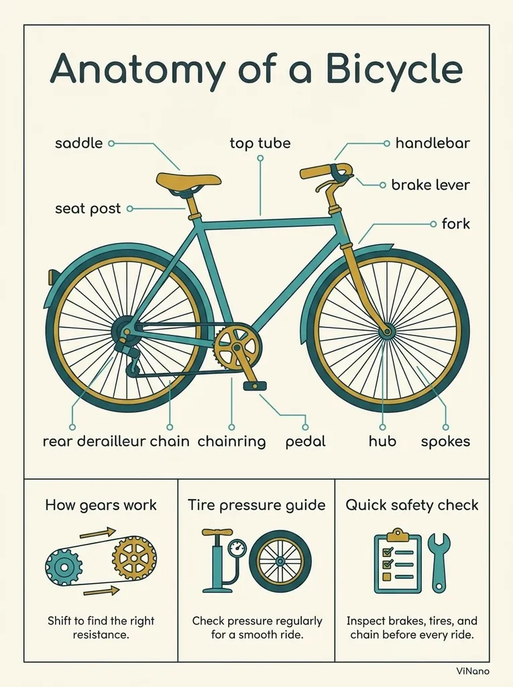

# Anatomy of a Bicycle Infographic

[← Back to the collection](../../README.md) · Category: [UI & Graphic](../../gallery/ui-graphic.md) · Model: `Nano Banana Pro` · ID: `vn-02171`

<a href="https://vinano.ai?utm_source=github&utm_medium=readme&utm_campaign=awesome-image-video-prompts-updating&utm_content=prompt-page-image"></a>

<sub>Preview generated with <a href="https://vinano.ai?utm_source=github&utm_medium=readme&utm_campaign=awesome-image-video-prompts-updating&utm_content=prompt-page-caption">vinano.ai</a> · added 2026-11-25</sub>

## Prompt

```text
A clean educational infographic poster titled "Anatomy of a Bicycle": a side-view flat illustration of a classic city bike in teal and mustard, with thin leader lines pointing to twelve labeled parts (saddle, seat post, top tube, handlebar, brake lever, fork, hub, spokes, chainring, pedal, chain, rear derailleur). Below the bike, three small panels explain "How gears work", "Tire pressure guide" and "Quick safety check" with simple icons and one short sentence each. Off-white paper background, tidy grid layout, rounded sans-serif typography, small "ViNano" credit in the bottom right corner, crisp vector look, all text spelled correctly.
```

## Try it on vinano.ai

1. Copy the prompt above.
2. Open **[vinano.ai](https://vinano.ai?utm_source=github&utm_medium=readme&utm_campaign=awesome-image-video-prompts-updating&utm_content=prompt-page-try)**, paste it into the image generator and pick a model.
3. Swap any placeholders (brand, product, city, person…) for your own details, then generate.

More prompts like this: [UI & Graphic gallery](../../gallery/ui-graphic.md) · [all categories](../../README.md#contents)
