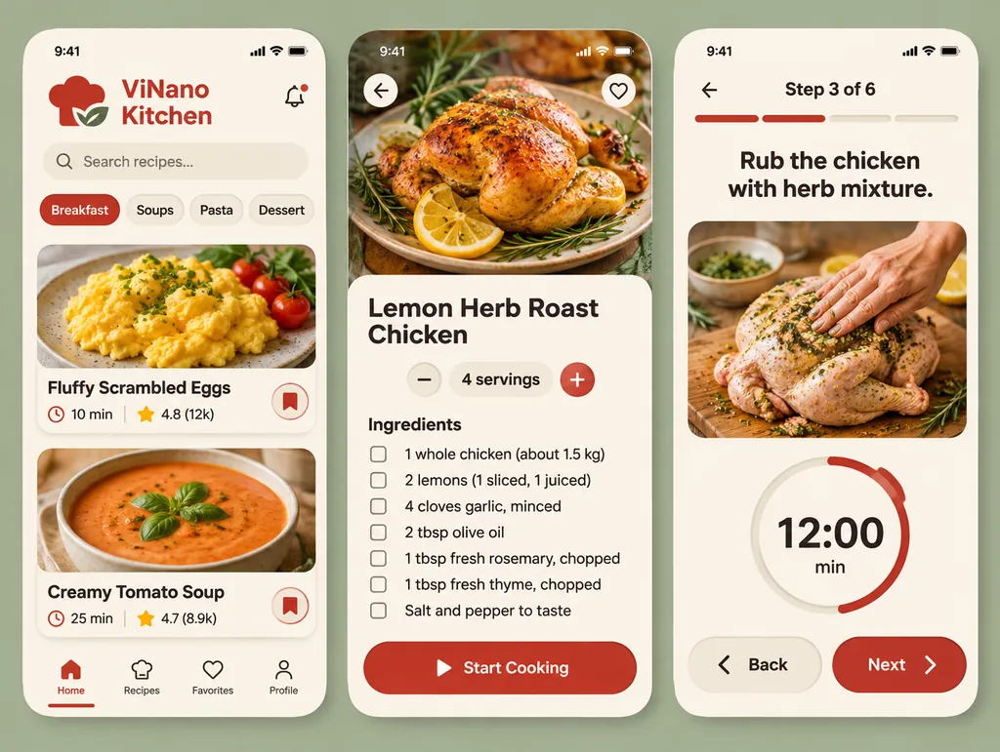

# Recipe App Mobile Screens

[← Back to the collection](../../README.md) · Category: [UI & Graphic](../../gallery/ui-graphic.md) · Model: `GPT Image 2.6 Flare` · ID: `vn-02172`

<a href="https://vinano.ai?utm_source=github&utm_medium=readme&utm_campaign=awesome-image-video-prompts-updating&utm_content=prompt-page-image"></a>

<sub>Preview generated with <a href="https://vinano.ai?utm_source=github&utm_medium=readme&utm_campaign=awesome-image-video-prompts-updating&utm_content=prompt-page-caption">vinano.ai</a> · added 2026-11-25</sub>

## Prompt

```text
Three mobile app screens shown side by side on a soft sage background for a cooking app called "ViNano Kitchen". Screen one: a home feed with a search bar, category chips (Breakfast, Soups, Pasta, Dessert) and two large recipe cards with photos, cook time and star ratings. Screen two: a recipe detail page for "Lemon Herb Roast Chicken" with a hero photo, a servings stepper, an ingredient checklist and a big "Start Cooking" button. Screen three: a step-by-step cooking mode showing "Step 3 of 6", a round timer at 12:00 and next/back buttons. Warm cream cards, tomato-red accent color, rounded corners, soft shadows, modern geometric sans-serif, pixel-sharp legible text, polished product design presentation.
```

## Try it on vinano.ai

1. Copy the prompt above.
2. Open **[vinano.ai](https://vinano.ai?utm_source=github&utm_medium=readme&utm_campaign=awesome-image-video-prompts-updating&utm_content=prompt-page-try)**, paste it into the image generator and pick a model.
3. Swap any placeholders (brand, product, city, person…) for your own details, then generate.

More prompts like this: [UI & Graphic gallery](../../gallery/ui-graphic.md) · [all categories](../../README.md#contents)
