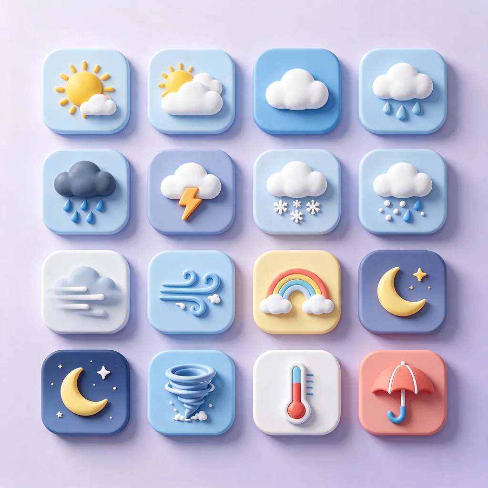

# Weather Icon Set in Soft 3D

[← Back to the collection](../../README.md) · Category: [UI & Graphic](../../gallery/ui-graphic.md) · Model: `Seedream 5.5` · ID: `vn-02178`

<a href="https://vinano.ai?utm_source=github&utm_medium=readme&utm_campaign=awesome-image-video-prompts-updating&utm_content=prompt-page-image"></a>

<sub>Preview generated with <a href="https://vinano.ai?utm_source=github&utm_medium=readme&utm_campaign=awesome-image-video-prompts-updating&utm_content=prompt-page-caption">vinano.ai</a> · added 2026-11-25</sub>

## Prompt

```text
A tidy 4 by 4 grid of sixteen weather icons in a soft 3D clay style on a pale lavender background: sun, partly cloudy, cloud, light rain, heavy rain, thunderstorm, snow, sleet, fog, wind, rainbow, crescent moon, starry night, tornado, thermometer and umbrella. Each icon sits on its own rounded square tile with a subtle drop shadow, uses the same pastel palette of butter yellow, sky blue, white and coral, and has matte rounded forms with gentle top-left lighting. Even spacing, consistent size and viewing angle, clean app icon pack presentation, no text.
```

## Try it on vinano.ai

1. Copy the prompt above.
2. Open **[vinano.ai](https://vinano.ai?utm_source=github&utm_medium=readme&utm_campaign=awesome-image-video-prompts-updating&utm_content=prompt-page-try)**, paste it into the image generator and pick a model.
3. Swap any placeholders (brand, product, city, person…) for your own details, then generate.

More prompts like this: [UI & Graphic gallery](../../gallery/ui-graphic.md) · [all categories](../../README.md#contents)
