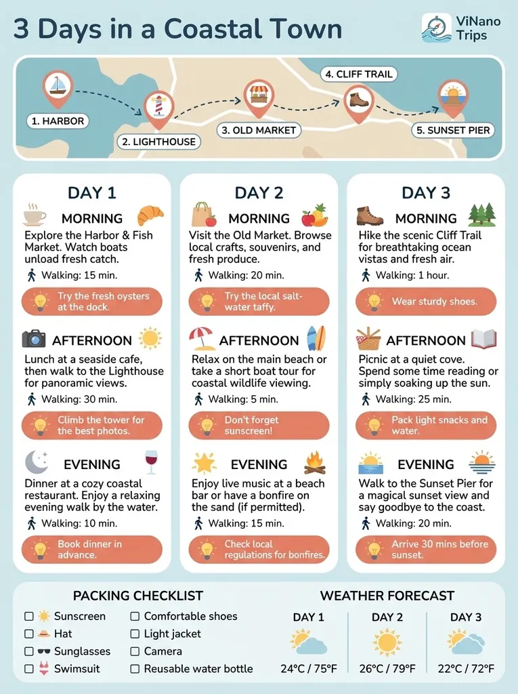

# Coastal Town Travel Itinerary Infographic

[← Back to the collection](../../README.md) · Category: [UI & Graphic](../../gallery/ui-graphic.md) · Model: `Nano Banana Pro` · ID: `vn-02181`

<a href="https://vinano.ai?utm_source=github&utm_medium=readme&utm_campaign=awesome-image-video-prompts-updating&utm_content=prompt-page-image"></a>

<sub>Preview generated with <a href="https://vinano.ai?utm_source=github&utm_medium=readme&utm_campaign=awesome-image-video-prompts-updating&utm_content=prompt-page-caption">vinano.ai</a> · added 2026-11-26</sub>

## Prompt

```text
A tidy one-page travel itinerary infographic titled "3 Days in a Coastal Town" designed for a trip-planning app called "ViNano Trips". A soft illustrated map strip runs across the top with a dotted route linking five numbered pins: harbor, lighthouse, old market, cliff trail and sunset pier. Below, three day columns (Day 1, Day 2, Day 3) each list morning, afternoon and evening plans with small flat icons, walking times and one short tip in a rounded callout. A footer row shows a packing checklist and a weather strip with three sunny-to-cloudy icons. Sea-blue, sand and coral palette, generous white space, clean rounded sans-serif type, all text crisp and correctly spelled.
```

## Try it on vinano.ai

1. Copy the prompt above.
2. Open **[vinano.ai](https://vinano.ai?utm_source=github&utm_medium=readme&utm_campaign=awesome-image-video-prompts-updating&utm_content=prompt-page-try)**, paste it into the image generator and pick a model.
3. Swap any placeholders (brand, product, city, person…) for your own details, then generate.

More prompts like this: [UI & Graphic gallery](../../gallery/ui-graphic.md) · [all categories](../../README.md#contents)
