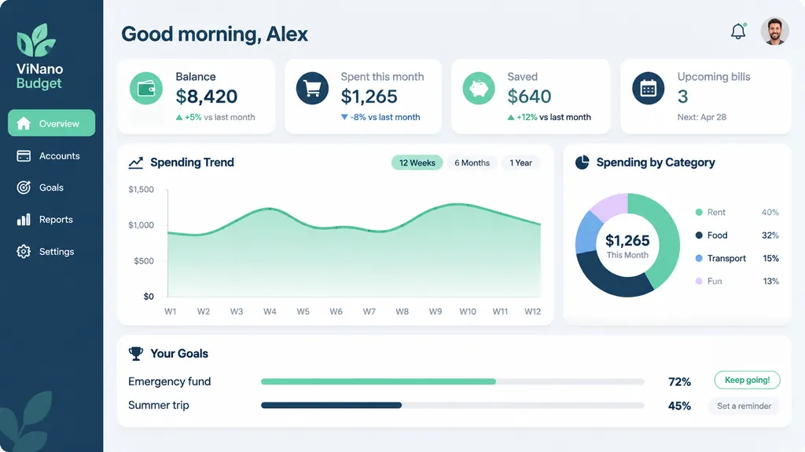

# Personal Finance Dashboard UI

[← Back to the collection](../../README.md) · Category: [UI & Graphic](../../gallery/ui-graphic.md) · Model: `GPT Image 2.6 Flare` · ID: `vn-02183`

<a href="https://vinano.ai?utm_source=github&utm_medium=readme&utm_campaign=awesome-image-video-prompts-updating&utm_content=prompt-page-image"></a>

<sub>Preview generated with <a href="https://vinano.ai?utm_source=github&utm_medium=readme&utm_campaign=awesome-image-video-prompts-updating&utm_content=prompt-page-caption">vinano.ai</a> · added 2026-11-26</sub>

## Prompt

```text
A desktop dashboard UI for a personal finance app called "ViNano Budget", shown flat on a light grey canvas. Left sidebar with icons for Overview, Accounts, Goals, Reports and Settings. Main area: a greeting "Good morning, Alex", four summary cards (Balance $8,420, Spent this month $1,265, Saved $640, Upcoming bills 3), a smooth area chart of spending over twelve weeks, a donut chart split into Rent, Food, Transport and Fun, and a goals panel with progress bars for "Emergency fund 72%" and "Summer trip 45%". Calm mint and navy palette, soft card shadows, rounded corners, clean sans-serif type, realistic product screenshot quality.
```

## Try it on vinano.ai

1. Copy the prompt above.
2. Open **[vinano.ai](https://vinano.ai?utm_source=github&utm_medium=readme&utm_campaign=awesome-image-video-prompts-updating&utm_content=prompt-page-try)**, paste it into the image generator and pick a model.
3. Swap any placeholders (brand, product, city, person…) for your own details, then generate.

More prompts like this: [UI & Graphic gallery](../../gallery/ui-graphic.md) · [all categories](../../README.md#contents)
