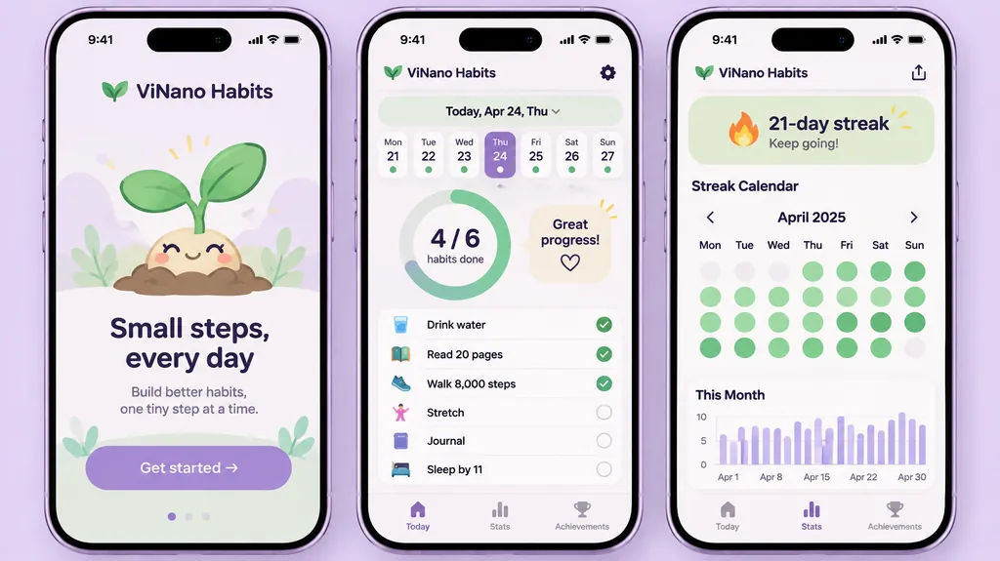

# ViNano Habits Tracker App Screens

[← Back to the collection](../../README.md) · Category: [UI & Graphic](../../gallery/ui-graphic.md) · Model: `GPT Image 2.6 Flare` · ID: `vn-02191`

<a href="https://vinano.ai?utm_source=github&utm_medium=readme&utm_campaign=awesome-image-video-prompts-updating&utm_content=prompt-page-image"></a>

<sub>Preview generated with <a href="https://vinano.ai?utm_source=github&utm_medium=readme&utm_campaign=awesome-image-video-prompts-updating&utm_content=prompt-page-caption">vinano.ai</a> · added 2026-11-27</sub>

## Prompt

```text
A clean mobile app screen set for a habit tracker called "ViNano Habits", three large iPhone screens side by side filling most of the frame on a soft lilac background. Screen one: onboarding with a friendly illustrated sprout and the line "Small steps, every day" plus a big rounded "Get started" button. Screen two: today view with a weekly date strip, a ring progress chart showing 4 of 6 habits done, and checklist rows for Drink water, Read 20 pages, Walk 8,000 steps, Stretch, Journal and Sleep by 11. Screen three: a streak calendar heatmap with "21-day streak" badge and a small bar chart of the month. Pastel lilac, mint and cream palette, rounded cards, soft shadows, crisp correctly spelled sans-serif text, polished Dribbble-quality UI.
```

## Try it on vinano.ai

1. Copy the prompt above.
2. Open **[vinano.ai](https://vinano.ai?utm_source=github&utm_medium=readme&utm_campaign=awesome-image-video-prompts-updating&utm_content=prompt-page-try)**, paste it into the image generator and pick a model.
3. Swap any placeholders (brand, product, city, person…) for your own details, then generate.

More prompts like this: [UI & Graphic gallery](../../gallery/ui-graphic.md) · [all categories](../../README.md#contents)
