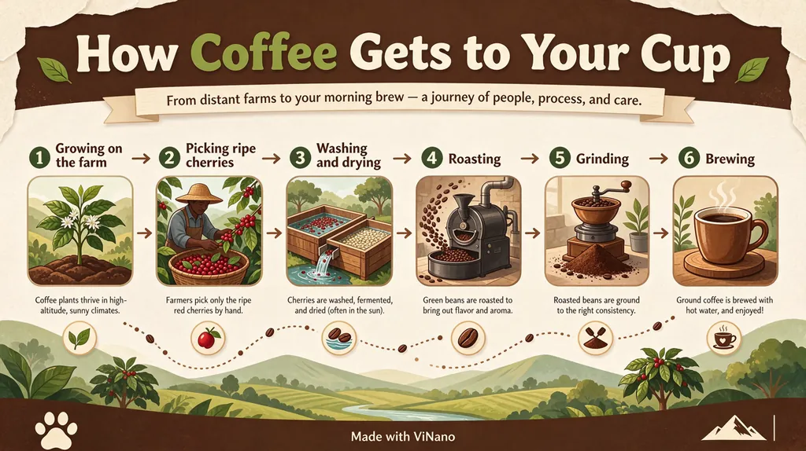

# How Coffee Gets to Your Cup Infographic

[← Back to the collection](../../README.md) · Category: [UI & Graphic](../../gallery/ui-graphic.md) · Model: `Seedream 5.5` · ID: `vn-02198`

<a href="https://vinano.ai?utm_source=github&utm_medium=readme&utm_campaign=awesome-image-video-prompts-updating&utm_content=prompt-page-image"></a>

<sub>Preview generated with <a href="https://vinano.ai?utm_source=github&utm_medium=readme&utm_campaign=awesome-image-video-prompts-updating&utm_content=prompt-page-caption">vinano.ai</a> · added 2026-11-27</sub>

## Prompt

```text
A flat vector infographic poster explaining "How Coffee Gets to Your Cup" as a left-to-right journey with six numbered stages: 1 Growing on the farm, 2 Picking ripe cherries, 3 Washing and drying, 4 Roasting, 5 Grinding, 6 Brewing. Each stage has a simple illustration, a one-line caption and a small icon, connected by a winding dotted path with tiny coffee beans. Header in a bold rounded font, a footer line "Made with ViNano". Earthy brown, cream and leaf green palette, clean modern layout, consistent line weight, all text crisp and correctly spelled.
```

## Try it on vinano.ai

1. Copy the prompt above.
2. Open **[vinano.ai](https://vinano.ai?utm_source=github&utm_medium=readme&utm_campaign=awesome-image-video-prompts-updating&utm_content=prompt-page-try)**, paste it into the image generator and pick a model.
3. Swap any placeholders (brand, product, city, person…) for your own details, then generate.

More prompts like this: [UI & Graphic gallery](../../gallery/ui-graphic.md) · [all categories](../../README.md#contents)
