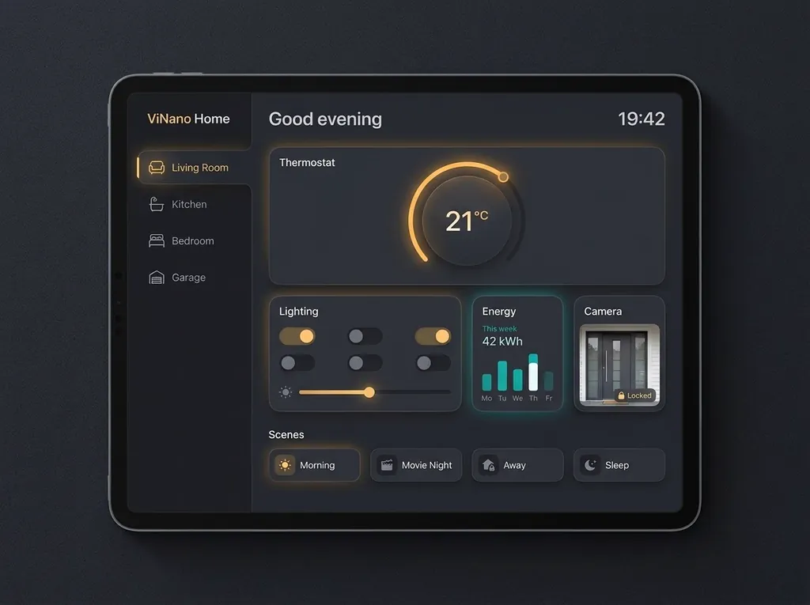

# ViNano Home Smart Dashboard

[← Back to the collection](../../README.md) · Category: [UI & Graphic](../../gallery/ui-graphic.md) · Model: `Nano Banana Pro` · ID: `vn-02201`

<a href="https://vinano.ai?utm_source=github&utm_medium=readme&utm_campaign=awesome-image-video-prompts-updating&utm_content=prompt-page-image"></a>

<sub>Preview generated with <a href="https://vinano.ai?utm_source=github&utm_medium=readme&utm_campaign=awesome-image-video-prompts-updating&utm_content=prompt-page-caption">vinano.ai</a> · added 2026-11-28</sub>

## Prompt

```text
A tablet smart-home control dashboard for an app called "ViNano Home", shown straight-on in dark mode on a deep charcoal background. Left sidebar with room tabs: Living Room, Kitchen, Bedroom, Garage. Main area made of rounded cards: a large thermostat dial set to 21°C with a glowing amber arc, a lighting card with four toggle switches and a brightness slider, an energy card with a small weekly bar chart labeled "This week 42 kWh", a front-door camera thumbnail with a "Locked" badge, and a row of scene buttons named Morning, Movie Night, Away and Sleep. Top bar shows "Good evening" and the time 19:42. Soft glassy cards, amber and teal accents, crisp readable sans-serif text, consistent 8-pixel spacing, modern product design showcase.
```

## Try it on vinano.ai

1. Copy the prompt above.
2. Open **[vinano.ai](https://vinano.ai?utm_source=github&utm_medium=readme&utm_campaign=awesome-image-video-prompts-updating&utm_content=prompt-page-try)**, paste it into the image generator and pick a model.
3. Swap any placeholders (brand, product, city, person…) for your own details, then generate.

More prompts like this: [UI & Graphic gallery](../../gallery/ui-graphic.md) · [all categories](../../README.md#contents)
