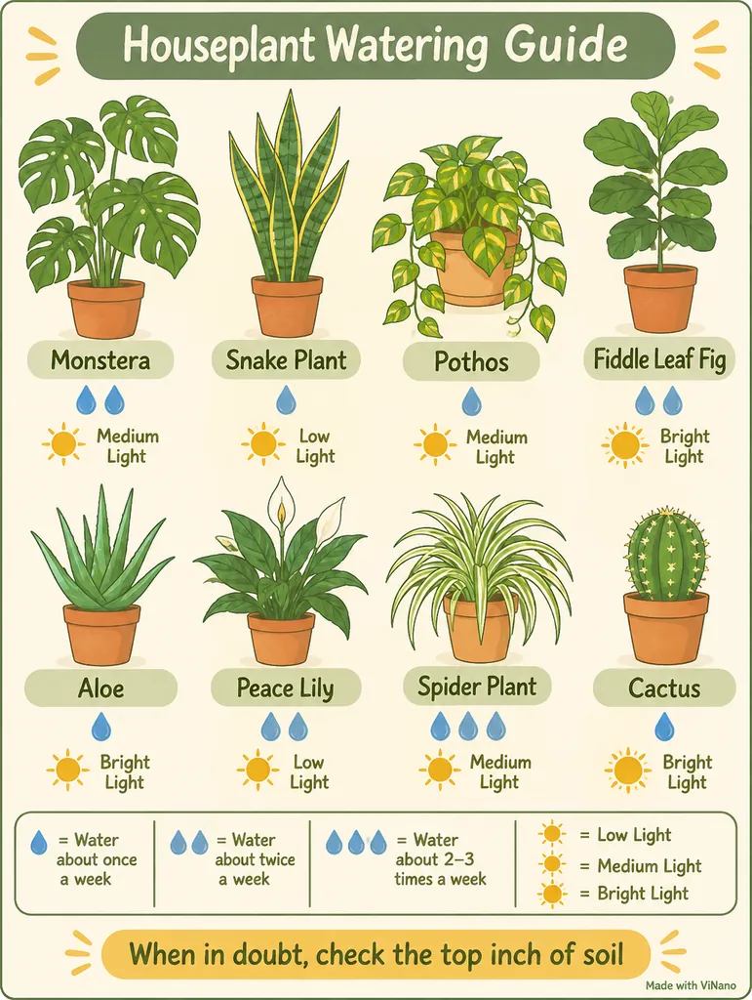

# Houseplant Watering Guide Cheat Sheet

[← Back to the collection](../../README.md) · Category: [UI & Graphic](../../gallery/ui-graphic.md) · Model: `GPT Image 2.6 Flare` · ID: `vn-02202`

<a href="https://vinano.ai?utm_source=github&utm_medium=readme&utm_campaign=awesome-image-video-prompts-updating&utm_content=prompt-page-image"></a>

<sub>Preview generated with <a href="https://vinano.ai?utm_source=github&utm_medium=readme&utm_campaign=awesome-image-video-prompts-updating&utm_content=prompt-page-caption">vinano.ai</a> · added 2026-11-28</sub>

## Prompt

```text
A friendly illustrated cheat-sheet infographic titled "Houseplant Watering Guide". A grid of eight potted plants drawn in a soft flat style with thin outlines: Monstera, Snake Plant, Pothos, Fiddle Leaf Fig, Aloe, Peace Lily, Spider Plant and Cactus. Under each plant: its name, a row of one to three water-drop icons for how often to water, and a small sun icon showing low, medium or bright light. A legend at the bottom explains the icons, followed by the tip line "When in doubt, check the top inch of soil". Tiny footer: "Made with ViNano". Cream background, sage green, terracotta and mustard palette, tidy grid, clear legible lettering.
```

## Try it on vinano.ai

1. Copy the prompt above.
2. Open **[vinano.ai](https://vinano.ai?utm_source=github&utm_medium=readme&utm_campaign=awesome-image-video-prompts-updating&utm_content=prompt-page-try)**, paste it into the image generator and pick a model.
3. Swap any placeholders (brand, product, city, person…) for your own details, then generate.

More prompts like this: [UI & Graphic gallery](../../gallery/ui-graphic.md) · [all categories](../../README.md#contents)
