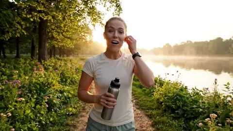

# Sunrise lakeside walk vlog

[← Back to the collection](../../README.md) · Category: [Video](../../gallery/video.md) · Model: `Veo 3.1 Lite` · ID: `vn-02120`

<a href="https://vinano.ai?utm_source=github&utm_medium=readme&utm_campaign=awesome-image-video-prompts-updating&utm_content=prompt-page-image"></a>

**[▶ Watch the full video (MP4 · 7.9s)](../../videos/vn-02120.mp4)** — the preview above is a short silent loop.

<sub>Video generated with <a href="https://vinano.ai?utm_source=github&utm_medium=readme&utm_campaign=awesome-image-video-prompts-updating&utm_content=prompt-page-caption">vinano.ai</a> · added 2026-11-18</sub>

## Prompt

```text
Create a hyper-realistic cinematic lifestyle vlog featuring a confident 23-year-old female content creator enjoying her peaceful sunrise walk along a scenic lakeside park surrounded by lush trees, blooming flowers, and soft morning mist. She wears a cream athletic T-shirt, sage-green running shorts, white sneakers, and a minimalist smartwatch. The atmosphere feels calm yet energetic, with premium lifestyle short-video aesthetics.

Use ultra-smooth gimbal tracking, cinematic handheld movement, dynamic whip transitions, speed ramps, shallow depth of field, natural lens flares, soft golden sunrise lighting, crisp ambient nature audio, and realistic facial expressions with accurate lip sync. No text overlays, logos, or watermarks.

Scene 1 (0–2 sec)

Close-up sequence of her putting on wireless earbuds, tightening her smartwatch strap, picking up a stainless-steel water bottle, and stepping onto the walking trail.

Dialogue:
“A fresh morning starts right here.”

⸻

Scene 2 (2–5 sec)

Front-facing selfie shot as she walks confidently with warm sunrise light filtering through the trees behind her. Gentle breeze moves her hair naturally.

Dialogue:
“The best part of the day is before the world wakes up.”

⸻

Scene 3 (5–8 sec)

Quick cinematic montage:

shoes landing softly on the path
smartwatch counting steps
sunlight shining through leaves
birds taking flight
dew sparkling on grass
close-up of her relaxed smile

Dialogue:
“Even a short walk makes everything feel lighter.”

⸻

Scene 4 (8–12 sec)

Elegant slow-motion shots of her stretching beside the lake, taking a deep breath, laughing naturally, and enjoying the warm morning glow.

Dialogue:
“A little movement… a lot more peace.”

⸻

Scene 5 (12–15 sec)

She looks back toward the camera with a bright smile, gives a friendly wave, and continues walking toward the sunrise as the camera slowly pulls away.

Dialogue:
“Same time tomorrow?”
```

## Try it on vinano.ai

1. Copy the prompt above.
2. Open **[vinano.ai](https://vinano.ai?utm_source=github&utm_medium=readme&utm_campaign=awesome-image-video-prompts-updating&utm_content=prompt-page-try)**, paste it into the video generator and pick a model.
3. Swap any placeholders (brand, product, city, person…) for your own details, then generate.

More prompts like this: [Video gallery](../../gallery/video.md) · [all categories](../../README.md#contents)
