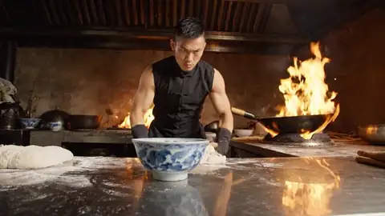

# Kung fu chef pulling noodles over open flames

[← Back to the collection](../../README.md) · Category: [Video](../../gallery/video.md) · Model: `Veo 3.1 Lite` · ID: `vn-02121`

<a href="https://vinano.ai?utm_source=github&utm_medium=readme&utm_campaign=awesome-image-video-prompts-updating&utm_content=prompt-page-image"></a>

**[▶ Watch the full video (MP4 · 7.9s)](../../videos/vn-02121.mp4)** — the preview above is a short silent loop.

<sub>Video generated with <a href="https://vinano.ai?utm_source=github&utm_medium=readme&utm_campaign=awesome-image-video-prompts-updating&utm_content=prompt-page-caption">vinano.ai</a> · added 2026-11-18</sub>

## Prompt

```text
SUBJECTS:
Subject 1: Lean kung fu chef with short, sharp-cut hair and defined jawline. Wears a modernized Chinese chef outfit fused with martial arts attire: fitted sleeveless upper garment with mandarin collar, dark matte fabric with subtle sheen; forearms wrapped with cloth bands for grip; loose tapered pants allowing wide stances; soft-soled shoes for silent footwork. Limbs slightly exaggerated in length; wrists highly flexible, elbows explosive. Movements follow clear martial rhythm (pause, burst, lock), with grounded footwork and fast pivots.

ENVIRONMENT:
Traditional Chinese open-fire stove setup; iron wok fixed on stove; reflective metal counter; blue-and-white porcelain bowl placed in foreground center. Warm overhead light combined with intense dynamic firelight; light oil smoke and visible heat distortion.

MOOD:
High tension, aggressive, but controlled and precise; performance feels intentional and elegant rather than chaotic.

TIMELINE:
0:00-0:02: Extreme close-up, wide-angle POV. The chef steps in, snaps his head up to lock eyes with camera, then stretches and folds the dough into even strands.
0:02-0:05: Slight handheld motion. He aligns the noodle strands through clean fold, align, and stretch cycles, then places them neatly on the counter.
0:05-0:07: He lowers into a sliding step. One palm sweeps across the counter and sends shrimp and greens in a controlled arc into the wok.
0:07-0:10: He controls the wok through the handle and qi force. Ingredients rise, rotate, and fall back as sparks and a controlled flame flare erupt.
0:10-0:12: He pivots, feeds the same noodle bundle directly into the wok, and completes three increasingly fast toss cycles.
0:12-0:15: Sudden full stop. He slides the finished noodles, shrimp, and glossy greens into the porcelain bowl, presents it to camera, and steam covers the lens for a clean fade-out.
```

## Try it on vinano.ai

1. Copy the prompt above.
2. Open **[vinano.ai](https://vinano.ai?utm_source=github&utm_medium=readme&utm_campaign=awesome-image-video-prompts-updating&utm_content=prompt-page-try)**, paste it into the video generator and pick a model.
3. Swap any placeholders (brand, product, city, person…) for your own details, then generate.

More prompts like this: [Video gallery](../../gallery/video.md) · [all categories](../../README.md#contents)
