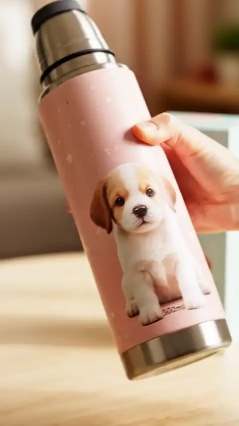

# UGC review of a puppy-print thermos

[← Back to the collection](../../README.md) · Category: [Video](../../gallery/video.md) · Model: `Veo 3.1 Lite` · ID: `vn-02125`

<a href="https://vinano.ai?utm_source=github&utm_medium=readme&utm_campaign=awesome-image-video-prompts-updating&utm_content=prompt-page-image"></a>

**[▶ Watch the full video (MP4 · 7.9s)](../../videos/vn-02125.mp4)** — the preview above is a short silent loop.

<sub>Video generated with <a href="https://vinano.ai?utm_source=github&utm_medium=readme&utm_campaign=awesome-image-video-prompts-updating&utm_content=prompt-page-caption">vinano.ai</a> · added 2026-11-18</sub>

## Prompt

```text
Create an ultra-realistic vertical (9:16) UGC-style commercial product review video featuring a cute 500ml stainless steel thermos bottle with a pink and cream puppy design. Use soft natural morning light, warm pastel colors, shallow depth of field, cinematic product shots, smooth handheld camera movement, a cozy lifestyle environment, premium commercial quality, realistic reflections, detailed textures, smooth focus transitions, and soft background bokeh.

0-1.2s: A hand holds the thermos close to the camera with a slight rotation.
1.2-2.4s: Place the thermos beside its packaging box on a clean table.
2.4-3.6s: Macro close-up inside the bottle highlighting the stainless steel interior.
3.6-4.8s: Close-up of the lid opening using the one-click lock mechanism.
4.8-6.0s: Crystal-clear water is poured into the thermos.
6.0-7.2s: The bottle stands on an outdoor picnic table beside books and snacks.
7.2-8.4s: Macro shot of the anti-slip bottom.
8.4-10.0s: A hand picks up the thermos and ends with a clean hero shot. No on-screen text.
```

## Try it on vinano.ai

1. Copy the prompt above.
2. Open **[vinano.ai](https://vinano.ai?utm_source=github&utm_medium=readme&utm_campaign=awesome-image-video-prompts-updating&utm_content=prompt-page-try)**, paste it into the video generator and pick a model.
3. Swap any placeholders (brand, product, city, person…) for your own details, then generate.

More prompts like this: [Video gallery](../../gallery/video.md) · [all categories](../../README.md#contents)
