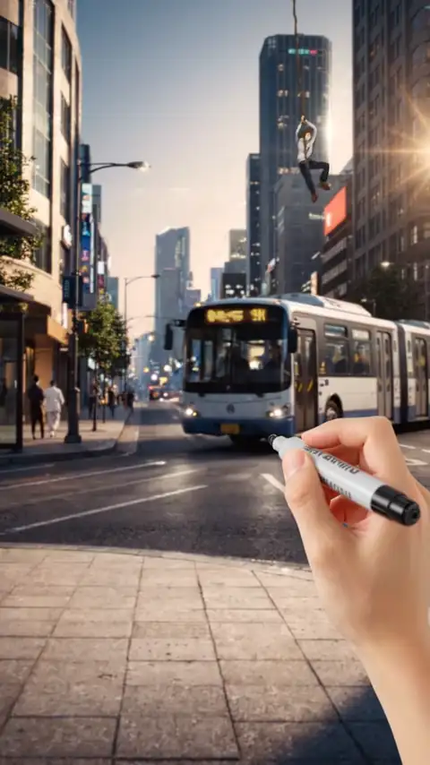

# Magic marker street vlog: doodles come alive

[← Back to the collection](../../README.md) · Category: [Video](../../gallery/video.md) · Model: `Veo 3.1 Lite` · ID: `vn-02127`

<a href="https://vinano.ai?utm_source=github&utm_medium=readme&utm_campaign=awesome-image-video-prompts-updating&utm_content=prompt-page-image"></a>

**[▶ Watch the full video (MP4 · 7.9s)](../../videos/vn-02127.mp4)** — the preview above is a short silent loop.

<sub>Video generated with <a href="https://vinano.ai?utm_source=github&utm_medium=readme&utm_campaign=awesome-image-video-prompts-updating&utm_content=prompt-page-caption">vinano.ai</a> · added 2026-11-18</sub>

## Prompt

```text
魔法笔街头魔法 Vlog，竖屏 9:16。实拍与扁平 2D 动漫贴纸合成，第一人称街头魔法 Vlog。8K 照片级细节，真实智能手机后置摄像头质感；照片级城市与扁平卡通角色形成强烈对比。一镜到底手持拍摄，无剪辑、无场景切换。

全程保留原始未稳定手持手机镜头：行走抖动、轻微手臂摇晃、偶尔自动对焦搜索、明亮天空与建筑阴影间的真实曝光变化。黄昏阳光来自一致方向，每个真实物体和动画角色都投下匹配阳光的柔和接触阴影。

Vlogger 的真实手握黑色马克笔并始终在画面中。每次变形都遵循相同序列：钢笔指向，Vlogger 说 Biu，蓝色手绘草图线条包裹目标，墨水扩散，目标变成活泼的扁平 2D 赛璐璐动漫角色，同时保持原始物体的大小、位置、速度、方向和透视。

0-3 秒：钢笔指向经过的地铁列车，一个小巧的扁平卡通小人抓着绳索在列车上荡行。
3-6 秒：钢笔指向人行道上的鸽子，鸽子变成可爱的手绘卡通鸟并飞走。
6-10 秒：城市公交车变成巨大的扁平 2D 橙色虎斑猫，保持公交车的速度和透视。
10-12 秒：公交站长椅上的女人变成生动的动漫插画并挥手。
12-15 秒：马克笔飞向天空画出蓝色墨水螺旋，真实天空变成手绘动漫天空。画面中不出现任何文字。
```

## Try it on vinano.ai

1. Copy the prompt above.
2. Open **[vinano.ai](https://vinano.ai?utm_source=github&utm_medium=readme&utm_campaign=awesome-image-video-prompts-updating&utm_content=prompt-page-try)**, paste it into the video generator and pick a model.
3. Swap any placeholders (brand, product, city, person…) for your own details, then generate.

More prompts like this: [Video gallery](../../gallery/video.md) · [all categories](../../README.md#contents)
