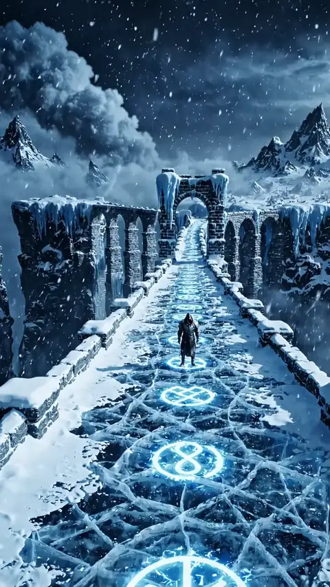

# Hooded knight on a frozen stone bridge

[← Back to the collection](../../README.md) · Category: [Video](../../gallery/video.md) · Model: `Veo 3.1 Lite` · ID: `vn-02128`

<a href="https://vinano.ai?utm_source=github&utm_medium=readme&utm_campaign=awesome-image-video-prompts-updating&utm_content=prompt-page-image"></a>

**[▶ Watch the full video (MP4 · 7.9s)](../../videos/vn-02128.mp4)** — the preview above is a short silent loop.

<sub>Video generated with <a href="https://vinano.ai?utm_source=github&utm_medium=readme&utm_campaign=awesome-image-video-prompts-updating&utm_content=prompt-page-caption">vinano.ai</a> · added 2026-11-18</sub>

## Prompt

```text
Style: Ultra-realistic cinematic, dark fantasy, hyper-realistic, 9:16 vertical, 8K, 60fps.

0-3s: A wide aerial shot reveals an ancient frozen stone bridge stretching over a bottomless icy canyon during blue hour. Snow falls steadily as blizzards sweep across distant mountains. Cracked ice glows with mysterious blue runes beneath the warrior's feet.

3-7s: The camera slowly circles behind a mysterious hooded warrior standing motionless on the bridge. A tattered black cloak whips violently in the freezing wind. Ultra-detailed medieval armor glistens with frost while a glowing silver sword reflects the icy surroundings.

7-11s: A low-angle tracking shot moves toward the warrior as they slowly raise the enchanted sword. The blue runes pulse brighter across the frozen bridge, snow swirls dramatically, and distant lightning illuminates the storm clouds.

11-15s: The warrior takes one powerful step forward. A shockwave of glowing blue energy races through the ancient runes beneath the ice. The camera rapidly pulls back into a breathtaking aerial view as the blizzard intensifies.
```

## Try it on vinano.ai

1. Copy the prompt above.
2. Open **[vinano.ai](https://vinano.ai?utm_source=github&utm_medium=readme&utm_campaign=awesome-image-video-prompts-updating&utm_content=prompt-page-try)**, paste it into the video generator and pick a model.
3. Swap any placeholders (brand, product, city, person…) for your own details, then generate.

More prompts like this: [Video gallery](../../gallery/video.md) · [all categories](../../README.md#contents)
