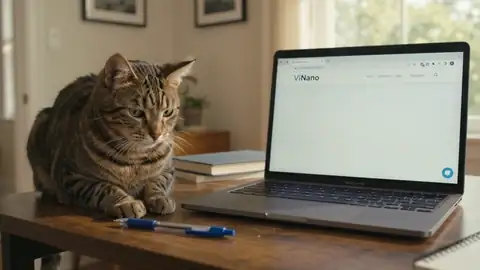

# Cat pushes a pen off the desk

[← Back to the collection](../../README.md) · Category: [Video](../../gallery/video.md) · Model: `Gemini Omni Flash` · ID: `vn-02131`

<a href="https://vinano.ai?utm_source=github&utm_medium=readme&utm_campaign=awesome-image-video-prompts-updating&utm_content=prompt-page-image"></a>

**[▶ Watch the full video (MP4 · 8.0s)](../../videos/vn-02131.mp4)** — the preview above is a short silent loop.

<sub>Video generated with <a href="https://vinano.ai?utm_source=github&utm_medium=readme&utm_campaign=awesome-image-video-prompts-updating&utm_content=prompt-page-caption">vinano.ai</a> · added 2026-11-18</sub>

## Prompt

```text
A tabby cat on a desk slowly pushes a pen off the edge while the laptop beside it shows a web page with the word "ViNano" at the top. The owner walks in, sighs and says, "Again?" The cat stares back innocently. Indoor daylight, the pen clatters on the floor, comedic timing.
```

## Try it on vinano.ai

1. Copy the prompt above.
2. Open **[vinano.ai](https://vinano.ai?utm_source=github&utm_medium=readme&utm_campaign=awesome-image-video-prompts-updating&utm_content=prompt-page-try)**, paste it into the video generator and pick a model.
3. Swap any placeholders (brand, product, city, person…) for your own details, then generate.

More prompts like this: [Video gallery](../../gallery/video.md) · [all categories](../../README.md#contents)
