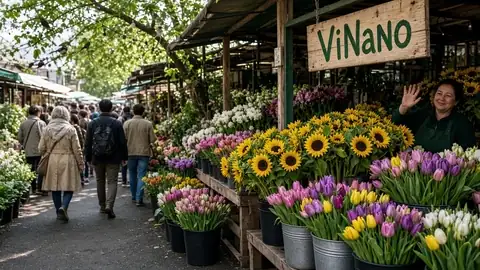

# Walking through a morning flower market

[← Back to the collection](../../README.md) · Category: [Video](../../gallery/video.md) · Model: `Grok Imagine` · ID: `vn-02137`

<a href="https://vinano.ai?utm_source=github&utm_medium=readme&utm_campaign=awesome-image-video-prompts-updating&utm_content=prompt-page-image"></a>

**[▶ Watch the full video (MP4 · 6.0s)](../../videos/vn-02137.mp4)** — the preview above is a short silent loop.

<sub>Video generated with <a href="https://vinano.ai?utm_source=github&utm_medium=readme&utm_campaign=awesome-image-video-prompts-updating&utm_content=prompt-page-caption">vinano.ai</a> · added 2026-11-18</sub>

## Prompt

```text
One continuous handheld shot walking through a busy flower market in the morning, past buckets of tulips and sunflowers, ending at a stall with a hand-painted wooden sign that reads "ViNano". The vendor waves hello. Natural crowd chatter and birdsong.
```

## Try it on vinano.ai

1. Copy the prompt above.
2. Open **[vinano.ai](https://vinano.ai?utm_source=github&utm_medium=readme&utm_campaign=awesome-image-video-prompts-updating&utm_content=prompt-page-try)**, paste it into the video generator and pick a model.
3. Swap any placeholders (brand, product, city, person…) for your own details, then generate.

More prompts like this: [Video gallery](../../gallery/video.md) · [all categories](../../README.md#contents)
