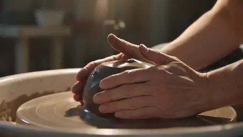

# Pottery Wheel Close-Up

[← Back to the collection](../../README.md) · Category: [Video](../../gallery/video.md) · Model: `Seedance 2.0 Mini` · ID: `vn-02149`

<a href="https://vinano.ai?utm_source=github&utm_medium=readme&utm_campaign=awesome-image-video-prompts-updating&utm_content=prompt-page-image"></a>

**[▶ Watch the full video (MP4 · 5.1s)](../../videos/vn-02149.mp4)** — the preview above is a short silent loop.

<sub>Video generated with <a href="https://vinano.ai?utm_source=github&utm_medium=readme&utm_campaign=awesome-image-video-prompts-updating&utm_content=prompt-page-caption">vinano.ai</a> · added 2026-11-19</sub>

## Prompt

```text
Close-up of wet clay rising into a tall vase on a spinning pottery wheel, two hands gently shaping the walls, slip glistening under warm studio light. The camera slowly dollies in and tilts up as the rim forms, shallow depth of field, dust motes floating in the background, calm handcrafted documentary feel.
```

## Try it on vinano.ai

1. Copy the prompt above.
2. Open **[vinano.ai](https://vinano.ai?utm_source=github&utm_medium=readme&utm_campaign=awesome-image-video-prompts-updating&utm_content=prompt-page-try)**, paste it into the video generator and pick a model.
3. Swap any placeholders (brand, product, city, person…) for your own details, then generate.

More prompts like this: [Video gallery](../../gallery/video.md) · [all categories](../../README.md#contents)
