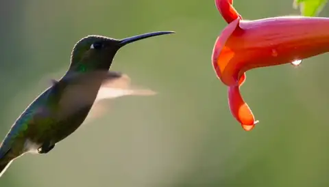

# Hummingbird at a Red Flower

[← Back to the collection](../../README.md) · Category: [Video](../../gallery/video.md) · Model: `MiniMax H3` · ID: `vn-02180`

<a href="https://vinano.ai?utm_source=github&utm_medium=readme&utm_campaign=awesome-image-video-prompts-updating&utm_content=prompt-page-image"></a>

**[▶ Watch the full video (MP4 · 5.2s)](../../videos/vn-02180.mp4)** — the preview above is a short silent loop.

<sub>Video generated with <a href="https://vinano.ai?utm_source=github&utm_medium=readme&utm_campaign=awesome-image-video-prompts-updating&utm_content=prompt-page-caption">vinano.ai</a> · added 2026-11-25</sub>

## Prompt

```text
Macro slow-motion shot of a green hummingbird hovering in front of a red trumpet-shaped flower in a sunlit garden. The camera holds steady and slowly pushes in as the bird dips its beak into the flower, its wings a soft blur, tiny pollen dust drifting in the backlight, then it backs away and hovers. Creamy green background blur, warm morning rim light on the feathers, shallow depth of field, crisp iridescent detail, nature documentary look.
```

## Try it on vinano.ai

1. Copy the prompt above.
2. Open **[vinano.ai](https://vinano.ai?utm_source=github&utm_medium=readme&utm_campaign=awesome-image-video-prompts-updating&utm_content=prompt-page-try)**, paste it into the video generator and pick a model.
3. Swap any placeholders (brand, product, city, person…) for your own details, then generate.

More prompts like this: [Video gallery](../../gallery/video.md) · [all categories](../../README.md#contents)
