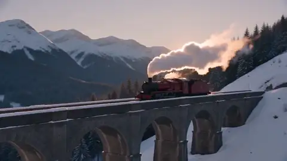

# Steam Train Crossing a Snowy Viaduct

[← Back to the collection](../../README.md) · Category: [Video](../../gallery/video.md) · Model: `Seedance 2.0 Mini` · ID: `vn-02210`

<a href="https://vinano.ai?utm_source=github&utm_medium=readme&utm_campaign=awesome-image-video-prompts-updating&utm_content=prompt-page-image"></a>

**[▶ Watch the full video (MP4 · 5.1s)](../../videos/vn-02210.mp4)** — the preview above is a short silent loop.

<sub>Video generated with <a href="https://vinano.ai?utm_source=github&utm_medium=readme&utm_campaign=awesome-image-video-prompts-updating&utm_content=prompt-page-caption">vinano.ai</a> · added 2026-11-28</sub>

## Prompt

```text
A vintage red steam train crosses a tall stone viaduct in a snowy mountain valley at golden hour. The drone camera orbits slowly around the bridge from the side, keeping the locomotive in frame as thick white steam trails behind and drifts over the pine forest below. Low sun lights the peaks pink, long shadows across the snow, smooth cinematic motion, crisp winter air.
```

## Try it on vinano.ai

1. Copy the prompt above.
2. Open **[vinano.ai](https://vinano.ai?utm_source=github&utm_medium=readme&utm_campaign=awesome-image-video-prompts-updating&utm_content=prompt-page-try)**, paste it into the video generator and pick a model.
3. Swap any placeholders (brand, product, city, person…) for your own details, then generate.

More prompts like this: [Video gallery](../../gallery/video.md) · [all categories](../../README.md#contents)
