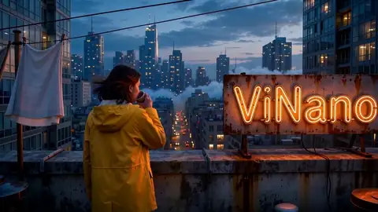

# Sky Whales Over a Rooftop at Dawn

[← Back to the collection](../../README.md) · Category: [Video](../../gallery/video.md) · Model: `MAGI-2` · ID: `vn-02218`

<a href="https://vinano.ai?utm_source=github&utm_medium=readme&utm_campaign=awesome-image-video-prompts-updating&utm_content=prompt-page-image"></a>

**[▶ Watch the full video (MP4 · 15.0s)](../../videos/vn-02218.mp4)** — the preview above is a short silent loop.

<sub>Video generated with <a href="https://vinano.ai?utm_source=github&utm_medium=readme&utm_campaign=awesome-image-video-prompts-updating&utm_content=prompt-page-caption">vinano.ai</a> · added 2026-11-28</sub>

## Prompt

```text
Photorealistic cinematic film scene, shot on a 35mm anamorphic lens with shallow depth of field, soft film grain and a teal-and-amber colour grade. One continuous 15-second take with no cuts.

Seconds 0-4: Blue hour just before sunrise on the flat rooftop of an old apartment block in a dense coastal city. Medium shot from behind a young woman in a yellow raincoat standing at the parapet with a paper cup of coffee. Beside her, a weathered rooftop sign made of warm orange neon letters reads "ViNano" and buzzes softly. Laundry lines sway in the breeze. A deep, slow whale call rolls across the skyline and the neon flickers once. She lowers the cup and looks up.

Seconds 4-10: The camera cranes up and over her shoulder as an enormous humpback whale glides out of the low clouds between the towers, swimming through the air as if it were water. Barnacles and pale scars are visible on its skin, mist streams off its long fins, and its shadow slides across the glass facades. Two more whales follow further back, one of them a calf keeping close to its mother. A flock of pigeons scatters. Windows light up one by one as the city wakes.

Seconds 10-15: The first sunbeam breaks over the horizon and turns the nearest whale's belly gold. It rolls slowly and its tail sweeps past just above the rooftop; the rush of air ripples her hair, her raincoat and the laundry. She turns half toward the camera with a wide, astonished smile and says quietly, "They came back." The camera settles into a slow push-in on her and the glowing "ViNano" sign while the whales drift away toward the sunrise.

Sound: deep resonant whale song, wind, distant city hum, fluttering wings, the electric buzz of the neon, and a soft string score that swells at sunrise. Natural lip sync for the single spoken line. No subtitles, no captions, no on-screen text other than the neon sign.
```

## Try it on vinano.ai

1. Copy the prompt above.
2. Open **[vinano.ai](https://vinano.ai?utm_source=github&utm_medium=readme&utm_campaign=awesome-image-video-prompts-updating&utm_content=prompt-page-try)**, paste it into the video generator and pick a model.
3. Swap any placeholders (brand, product, city, person…) for your own details, then generate.

More prompts like this: [Video gallery](../../gallery/video.md) · [all categories](../../README.md#contents)
