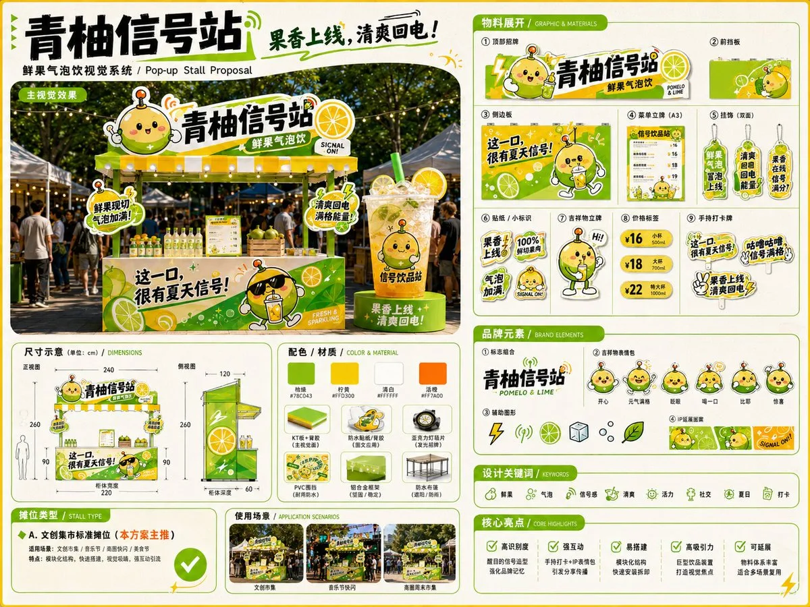

# Larus Canus — by @MrLarus

[← Back to Community Examples](../../EXAMPLES.md) · Category: Poster Design · Model: `GPT Image`

<a href="https://x.com/MrLarus/status/2058948398225482102"></a>

Source: **[@MrLarus on X](https://x.com/MrLarus/status/2058948398225482102)** · Creator: [Larus Canus](https://x.com/MrLarus)

## Prompt

```text
请根据以下用户输入，生成一张横版 4:3 的《创意集市摊位设计提案板 / Creative Market Stall Proposal Board》。

这不是单纯的摊位效果图，而是一张完整的品牌出摊视觉提案图，需要同时呈现：摊位实景渲染、物料展开、尺寸示意、配色材质、品牌元素、IP形象、使用场景和核心亮点。

【用户输入】
品牌名：【填写品牌名】
摊位主题：【填写主题，例如鲜果气泡饮 / 章鱼小丸子 / 甜品冰品 / 文创手作】
主营产品：【填写具体产品】
目标人群：【年轻人 / 学生 / 女性消费者 / 亲子家庭 / 文创市集人群等】
整体风格：【清爽活力 / 街头热食 / 梦幻甜美 / 文艺手作 / 复古可爱 / 高饱和潮流等】
主色调：【填写主色】
辅助色：【填写辅助色】
IP形象：【填写IP设定，例如青柚精灵 / 小丸子研究员 / 云朵精灵 / 邮差小狗】
核心口号：【填写一句短口号】
使用场景：【文创市集 / 美食市集 / 校园活动 / 音乐节 / 商场快闪 / 品牌路演】

【整体画面要求】
画面比例为横版 4:3。
整体是一张专业的摊位设计提案板，采用高信息量但清晰有序的版式。
画面需要有明显的设计感、提案感和商业落地感，不要像普通广告海报，也不要像单纯效果图。

整体视觉应融合：
1. 写实摊位渲染效果图
2. 平面物料展开图
3. 简化尺寸结构图
4. 品牌视觉系统展示
5. 手绘批注、箭头、圈注、marker 标记
6. 淡淡的纸张纹理或设计稿纹理背景

整体风格参考当代年轻人喜欢的文创集市、美食集市、快闪摊位、品牌市集摊位。  
需要新潮、好拍照、适合打卡传播，同时看起来真实可搭建、可落地执行。

【版式结构】
整张图应包含以下板块：

1. 顶部标题区
- 大标题：【品牌名】· 创意集市摊位设计提案
- 副标题：【主题品类】视觉系统 / Pop-up Stall Proposal
- 标题字体要有设计感，不能太普通
- 可以加入少量手绘符号、品牌图形、IP小头像或短口号

2. 主视觉效果区
- 左侧或画面核心区域放一张最大的摊位写实渲染图
- 场景为真实文创集市 / 户外市集 / 美食集市 / 商场快闪 / 校园活动等
- 需要有背景人流、帐篷、树木、灯串、摊位氛围，但人物不要喧宾夺主
- 摊位必须是“文创集市标准摊位”，不是三轮车、不是餐车
- 摊位结构包括：顶部异形招牌、前台围板、侧边围板、菜单立牌、挂牌、产品陈列、IP立牌、打卡装置、灯光或装饰物
- 主视觉要写实、清晰、有真实搭建感

3. 物料展开区 / Graphic & Materials
展示这套摊位涉及的主要物料设计，采用平铺设计稿方式呈现：
- 顶部招牌
- 前台围板
- 侧边围板
- 菜单立牌 A3
- 挂牌 / 双面吊牌
- 贴纸 / 小标识
- 吉祥物立牌
- 价格标签
- 手持打卡牌
每个物料旁边可以有简短编号和中文标签，排版要整洁，有设计提案感。

4. 尺寸示意区 / Dimensions
展示摊位的简化正视图和侧视图。
加入可信的尺寸标注，例如：
- 总宽度 240cm
- 总高度 260cm
- 柜体宽度 220cm
- 操作台高度 90cm
- 顶部招牌高度 70cm
- 侧面深度 60-120cm
尺寸不需要像 CAD 一样精确，但要看起来专业、合理、可落地。
可以加入人物比例剪影作为参照。

5. 配色 / 材质区 / Color & Material
展示 4-5 个色块，并标注色彩名称和近似 HEX 色值。
展示推荐材质，例如：
- KT板
- 雪弗板
- 泡沫板异形切割
- 亚克力灯箱
- PVC贴纸
- 防水喷绘布
- 金属框架
- 木纹板 / 布旗 / 灯串等
材质展示要像设计提案板，不要过于杂乱。

6. 品牌元素区 / Brand Elements
展示完整品牌视觉系统：
- Logo组合
- IP吉祥物
- 吉祥物表情包
- 辅助图形
- 产品图标
- 底纹 / 延展图案
- 小贴纸元素
这一块要体现品牌可延展性，而不是只做一个摊位外观。

7. 摊位类型区 / Stall Type
明确写出：
A. 文创集市标准摊位（本方案主推）
说明适用场景：
文创市集 / 美食市集 / 校园活动 / 音乐节 / 商场快闪 / 品牌路演
说明特点：
模块化搭建、运输方便、视觉醒目、适合拍照打卡、物料可复用。

注意：本图只展示“文创集市标准摊位”，不要展示三轮车流动摊位。

8. 使用场景 / 设计关键词 / 核心亮点
底部可以加入小型信息栏：
- 使用场景：文创市集、校园活动、音乐节、商场快闪、品牌路演
- 设计关键词：年轻、打卡、社交、模块化、高识别、可延展
- 核心亮点：高辨识度、易搭建、强互动、高传播、可复用、适合商业落地

【视觉风格要求】
整体画面要明亮、有冲击力，避免颜色太淡、太灰、太暗。
提高对比度，主色要更饱和，标题和重点信息要清晰有力。
背景可以使用淡淡的纸张纹理、印刷纹理、设计稿纹理或浅色图案，但不能抢主体。
版式要专业、整洁、有层次，像设计师给客户做的完整摊位提案板。
可以加入少量手绘箭头、圈注、便利贴感批注、marker笔记，增强提案氛围。

中文文字要简洁，不要塞太多长句。
主标题、板块标题、口号、标签尽量清晰准确。
所有品牌名、口号、IP和物料文字都必须原创，不要复制任何参考图里的品牌、标语或具体文字。

【最终效果】
生成一张完整、专业、年轻化、高完成度的创意集市摊位设计提案板。
它应该看起来像一个小品牌从 0 到 1 的出摊视觉系统方案：
既有真实摊位落地效果，又有物料设计、尺寸说明、品牌系统和商业应用场景。
```

## Try it

Paste the prompt into **[vinano.ai](https://vinano.ai?utm_source=github&utm_medium=readme&utm_campaign=awesome-image-video-prompts-updating&utm_content=x-page-try)** to generate your own version.

> The image and prompt belong to @MrLarus ([original post](https://x.com/MrLarus/status/2058948398225482102)) and are shown here with credit for reference. Creators can ask for changes or removal by opening an issue.
