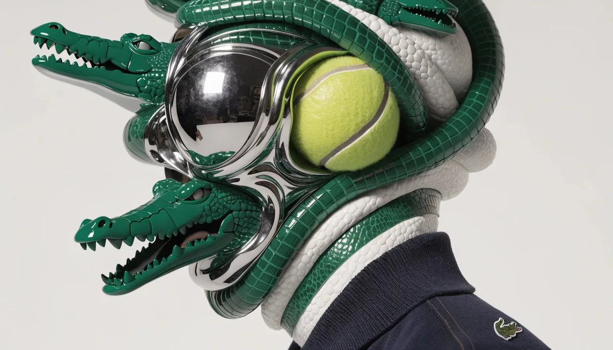

# AI Pulse — by @youraipulse

[← Back to Community Examples](../../EXAMPLES.md) · Category: Illustration & 3D · Model: `Nano Banana`

<a href="https://x.com/youraipulse/status/2041238850962382939"></a>

Source: **[@youraipulse on X](https://x.com/youraipulse/status/2041238850962382939)** · Creator: [AI Pulse](https://x.com/youraipulse)

## Prompt

```text
[BRAND]. A hyperrealistic editorial photo of a figure wearing a unique helmet or mask that embodies the soul of BRAND turned inside out - its textures, symbols, colors and DNA reconstructed into an unexpected wearable object covering the entire face. The mask is made of BRAND's signature materials but distorted, inverted, reimagined as armor. Dramatic studio lighting, clean or atmospheric background, macro detail on every surface, Vogue editorial style, 8K
```

## Try it

Paste the prompt into **[vinano.ai](https://vinano.ai?utm_source=github&utm_medium=readme&utm_campaign=awesome-image-video-prompts-updating&utm_content=x-page-try)** to generate your own version.

> The image and prompt belong to @youraipulse ([original post](https://x.com/youraipulse/status/2041238850962382939)) and are shown here with credit for reference. Creators can ask for changes or removal by opening an issue.
