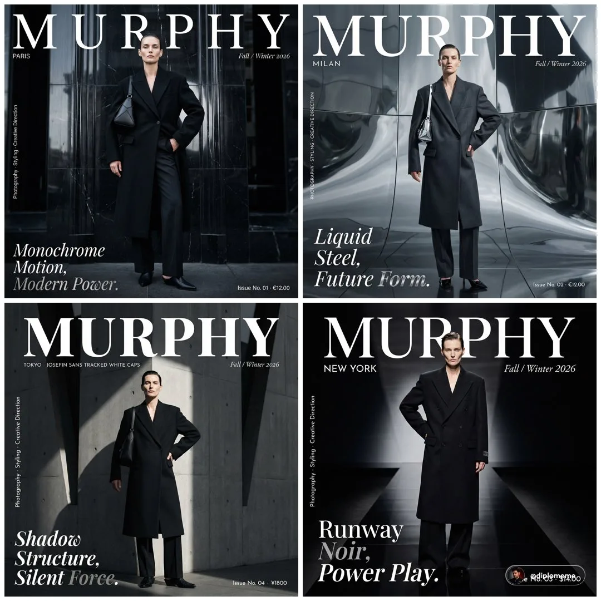

# ᴍᴜʀᴘʜʏ — by @Diplomeme

[← Back to Community Examples](../../EXAMPLES.md) · Category: Poster Design · Model: `Nano Banana`

<a href="https://x.com/Diplomeme/status/2041196287077597676"></a>

Source: **[@Diplomeme on X](https://x.com/Diplomeme/status/2041196287077597676)** · Creator: [ᴍᴜʀᴘʜʏ](https://x.com/Diplomeme)

## Prompt

```text
Murphy magazine fashion editorial photograph. Androgynous model early 30s, sharp bone structure, flawless skin, hair slicked back, neutral composed expression, standing perfectly straight full body centered against a massive polished black marble architectural facade — reflective stone, towering vertical panels, subtle veining, high-gloss luxury surface. Wearing an immaculate oversized black double-breasted long coat single button fastened, black wide-leg trousers with razor sharp centre crease, black leather pointed toe mule, one sculptural black leather architectural bag on left shoulder, designer Louis Vuitton. Left hand on hip, right arm hanging, chin slightly raised, looking directly into lens with complete calm authority. High-gloss cinematic lighting with controlled studio key light from left, cool monochrome highlights carving sharp reflections across coat and marble surface, face precisely sculpted with high contrast shadow and highlight. Background: deep black marble fills entire frame zero sky visible — tonal black on black ultra luxury.

Typography overlaid exactly as Murphy magazine cover: top center — “MURPHY” in massive modern serif 90px white, letter-spaced 20px. Below masthead left — “PARIS” in 8px Josefin Sans tracked white caps. Top right — “Fall / Winter 2026” in 9px italic Cormorant Garamond white. Bottom left — editorial headline in stacked Playfair Display italic: “Monochrome” line 1, “Motion,” line 2, “Modern Power.” line 3 — 52px white, “Power.” in metallic silver. Bottom right — “Issue No. 01 · €12.00” in 8px tracked Josefin Sans white. Left edge vertical — “Photography · Styling · Creative Direction” in 7px white caps rotated 90 degrees.

Shot on Hasselblad H6D-400C, 85mm, shallow DOF, glossy marble bokeh, HDR, Murphy high-gloss fashion editorial cover, 4:5 portrait
```

## Try it

Paste the prompt into **[vinano.ai](https://vinano.ai?utm_source=github&utm_medium=readme&utm_campaign=awesome-image-video-prompts-updating&utm_content=x-page-try)** to generate your own version.

> The image and prompt belong to @Diplomeme ([original post](https://x.com/Diplomeme/status/2041196287077597676)) and are shown here with credit for reference. Creators can ask for changes or removal by opening an issue.
