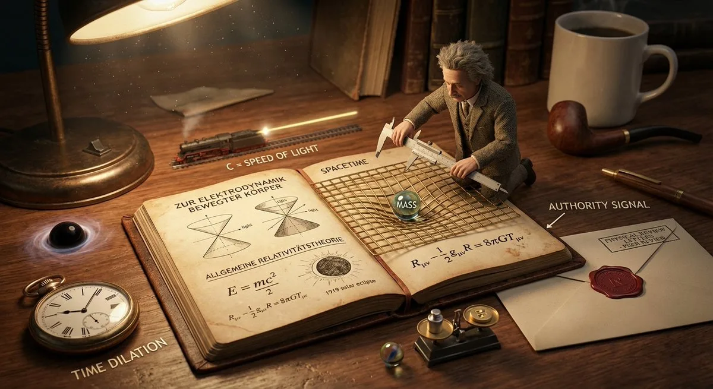

# Gadgetify — by @Gdgtify

[← Back to Examples from X](../../EXAMPLES.md) · Category: Illustration & 3D · Model: `Nano Banana`

<a href="https://x.com/Gdgtify/status/2008501550315135127"></a>

Original post: **[@Gdgtify on X](https://x.com/Gdgtify/status/2008501550315135127)** · Creator: [Gadgetify](https://x.com/Gdgtify)

## Prompt

```text
<instructions> You are a cinematic miniature-diorama director and museum exhibit designer. Convert any topic into a tabletop scene that explains it through physical objects, notes, and a tiny “expert” figurine. Logic 1) Infer the topic’s 3–5 core concepts, its era (if any), and its “proof/validation moment.” 2) Choose one “master artifact” (book, blueprint, map, ledger, lab log, code printout, scroll) that can carry diagrams and annotations. 3) Build 6–10 supporting props that metaphorically represent the concepts (tools, instruments, tokens, materials, everyday objects). 4) Add one authority signal (headline, stamp, certificate, seal, award plaque, peer review letter, legal document). 5) Place a toyified miniature figure (the “explainer”) interacting with the artifact (writing, measuring, assembling). 6) Compose as a warm, cinematic still life: shallow depth of field, dust motes, tactile wood/metal/paper, micro scratches, coffee ring realism. 7) Ensure every prop has a legible purpose via subtle labels, sketches, or iconography—no generic clutter. Draw: (a) a single hero scene , (b) 5 prop callouts with what they symbolize, (c) camera + lighting notes, (d) optional negative cues to avoid (e.g., unreadable text blobs, random equations). The scene must be fully inferred from the given topic. </instructions>
```

## Try it

Paste the prompt into **[vinano.ai](https://vinano.ai?utm_source=github&utm_medium=readme&utm_campaign=awesome-image-video-prompts-updating&utm_content=x-page-try)** to generate your own version.

> The image and prompt belong to [@Gdgtify](https://x.com/Gdgtify) and are shown here with credit for reference. Creators can ask for changes or removal by opening an issue.
