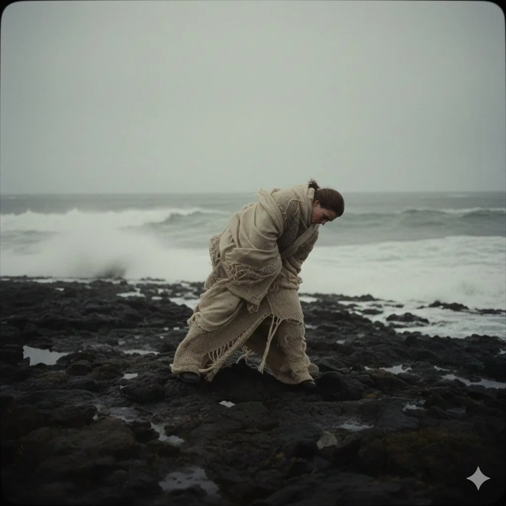

# Vera Collins — by @PiyariArisha

[← Back to Examples from X](../../EXAMPLES.md) · Category: Photography · Model: `Nano Banana`

<a href="https://x.com/PiyariArisha/status/2011114481015795906"></a>

Original post: **[@PiyariArisha on X](https://x.com/PiyariArisha/status/2011114481015795906)** · Creator: [Vera Collins](https://x.com/PiyariArisha)

## Prompt

```text
Sometimes I want to stay alone away from the Chaos of City life 

The Realism by gemini nano banana 
Prompt 👇

Wide shot, subject acts as an anchor against a raging wind. Standing on a jagged black rock coastline, waves crashing behind in a gray blur. The subject leans forward against the gale. Outfit is a massive, shapeless layers of raw beige wool and distressed knitwear, creating a silhouette that looks like a eroding sculpture. Lighting is overcast, flat, and moody. Desaturated palette, muted earth tones, sharp texture on the fabric, cinematic anamorphic lens.

Negative Prompt: Sunny beach, vacation vibes, swimsuit, smiling, blue sky, vibrant colors, calm water, generic travel photography, face distortion.
```

## Try it

Paste the prompt into **[vinano.ai](https://vinano.ai?utm_source=github&utm_medium=readme&utm_campaign=awesome-image-video-prompts-updating&utm_content=x-page-try)** to generate your own version.

> The image and prompt belong to [@PiyariArisha](https://x.com/PiyariArisha) and are shown here with credit for reference. Creators can ask for changes or removal by opening an issue.
