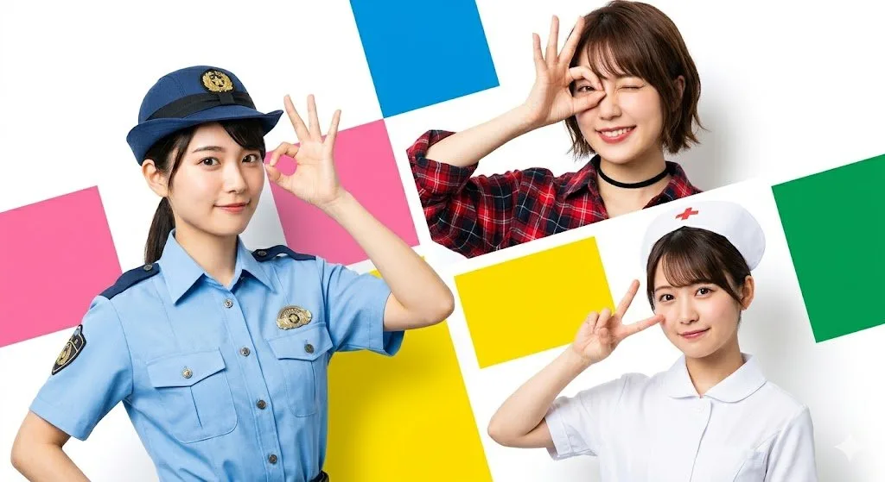

# Cherry 2.O — by @Mind_Boticni

[← Back to Examples from X](../../EXAMPLES.md) · Category: UI & Graphic · Model: `Nano Banana`

<a href="https://x.com/Mind_Boticni/status/2041188242846888389"></a>

Original post: **[@Mind_Boticni on X](https://x.com/Mind_Boticni/status/2041188242846888389)** · Creator: [Cherry 2.O](https://x.com/Mind_Boticni)

## Prompt

```text
High-resolution Japanese commercial advertisement style photo, three young women posing against a clean white background with bold geometric color blocks (blue, pink, yellow, green) arranged diagonally.
Top right: woman with short brown hair wearing a red and black plaid shirt and black choker, winking and making an “OK” hand gesture over one eye.

Left: woman in a light blue police uniform with cap, making an “OK” gesture near her eye with a playful expression.

Bottom right: woman dressed as a nurse in a white outfit and cap, making a peace (V) sign with a cute expression.
Bright studio lighting, soft shadows, vibrant colors, sharp focus, clean commercial composition, modern Japanese advertising aesthetic, playful and energetic mood, ultra-detailed, crisp skin tones.
No text, no logos, no typography anywhere in the image.
```

## Try it

Paste the prompt into **[vinano.ai](https://vinano.ai?utm_source=github&utm_medium=readme&utm_campaign=awesome-image-video-prompts-updating&utm_content=x-page-try)** to generate your own version.

> The image and prompt belong to [@Mind_Boticni](https://x.com/Mind_Boticni) and are shown here with credit for reference. Creators can ask for changes or removal by opening an issue.
