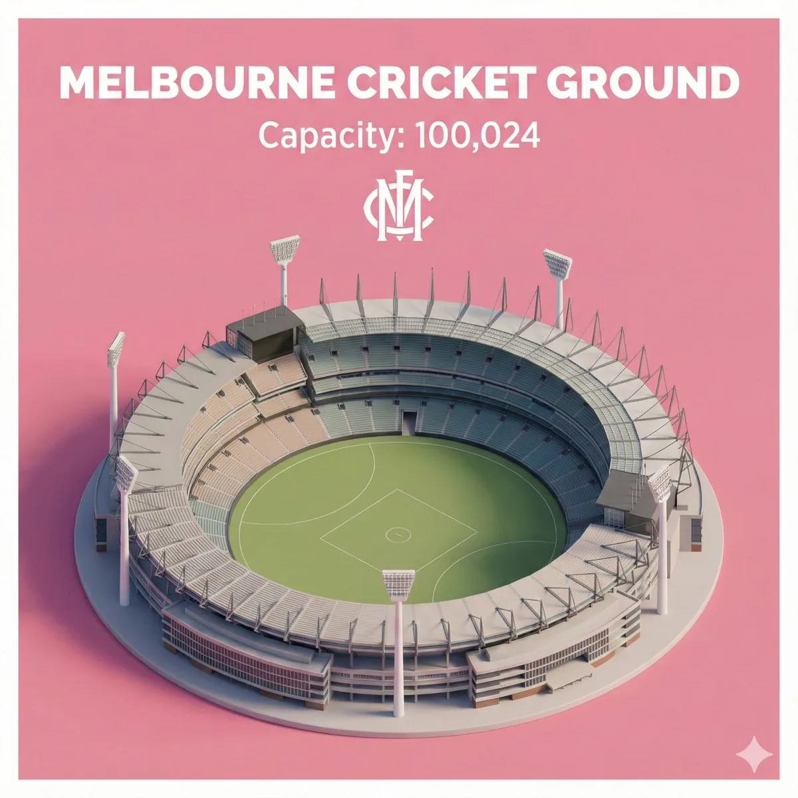

# Milo — by @Milo_Bahi_02

[← Back to Examples from X](../../EXAMPLES.md) · Category: Illustration & 3D · Model: `Nano Banana`

<a href="https://x.com/Milo_Bahi_02/status/2011045292209291663"></a>

Original post: **[@Milo_Bahi_02 on X](https://x.com/Milo_Bahi_02/status/2011045292209291663)** · Creator: [Milo](https://x.com/Milo_Bahi_02)

## Prompt

```text
Ultra-Realistic Promotional
Present a clear, 45° top-down isometric miniature 3D cartoon scene of [MELBOURNE CRICKET STADIUM], with soft refined textures, realistic PBR materials, and gentle lifelike lighting. Use a clean solid [GREEN, WHITE OR PINK ] background. At the top center, display the name of this stadium in large bold text, then directly beneath it show its real seating capacity in medium text, and place the official logo associated with this stadium below the capacity. All text must match the background contrast automatically (white or black). Centered layout, square 1080×1080 dimension.
```

## Try it

Paste the prompt into **[vinano.ai](https://vinano.ai?utm_source=github&utm_medium=readme&utm_campaign=awesome-image-video-prompts-updating&utm_content=x-page-try)** to generate your own version.

> The image and prompt belong to [@Milo_Bahi_02](https://x.com/Milo_Bahi_02) and are shown here with credit for reference. Creators can ask for changes or removal by opening an issue.
