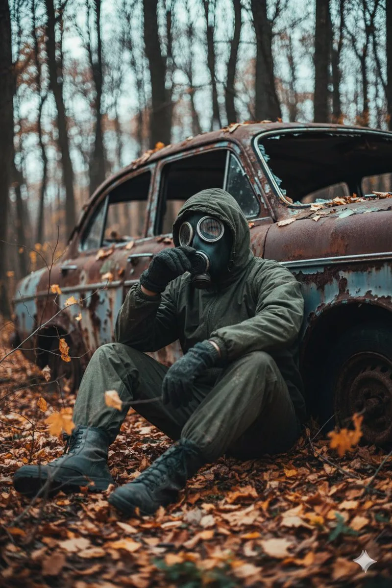

# Harboriis — by @harboriis

[← Back to Examples from X](../../EXAMPLES.md) · Category: Photography · Model: `Nano Banana`

<a href="https://x.com/harboriis/status/2011669368787345614"></a>

Original post: **[@harboriis on X](https://x.com/harboriis/status/2011669368787345614)** · Creator: [Harboriis](https://x.com/harboriis)

## Prompt

```text
A cinematic, ultra realistic post apocalyptic scene of a lone survivor sitting on the forest ground, leaning against an abandoned, rusted old car with broken windows and peeling paint. The survivor is wearing a dark olive green hooded protective suit with visible fabric folds and dirt stains, heavy boots, gloves, and a full face gas mask with round glass lenses and dual side filters. The survivor is sitting with knees bent, one hand near the mask as if thinking, body slightly slouched, giving a feeling of exhaustion and solitude.
The environment is a dense, overgrown forest in late autumn, with dry orange, brown, and golden leaves covering the ground and hanging on thin branches. The background trees are tall and thin with dark trunks, softly blurred by shallow depth of field. Small plants, twigs, and fallen leaves fill the foreground creating a natural frame.
Color palette is muted and cinematic: deep olive greens, rusty browns, burnt orange leaves, dark greys, faded blue metal on the car, and soft warm highlights mixed with cool shadow tones. Lighting is soft and diffused, as if coming from an overcast sky, with gentle warm light touching the leaves and the subject, and cooler shadows in the background. Slight film grain, cinematic contrast, moody and atmospheric tone.
Camera is low angle, medium full body shot, subject placed slightly off center, 35mm lens look, shallow depth of field, realistic textures, high detail, soft background blur, subtle vignette. The atmosphere feels quiet, abandoned, melancholic, and tense, like the world has ended and nature is slowly taking over.
```

## Try it

Paste the prompt into **[vinano.ai](https://vinano.ai?utm_source=github&utm_medium=readme&utm_campaign=awesome-image-video-prompts-updating&utm_content=x-page-try)** to generate your own version.

> The image and prompt belong to [@harboriis](https://x.com/harboriis) and are shown here with credit for reference. Creators can ask for changes or removal by opening an issue.
