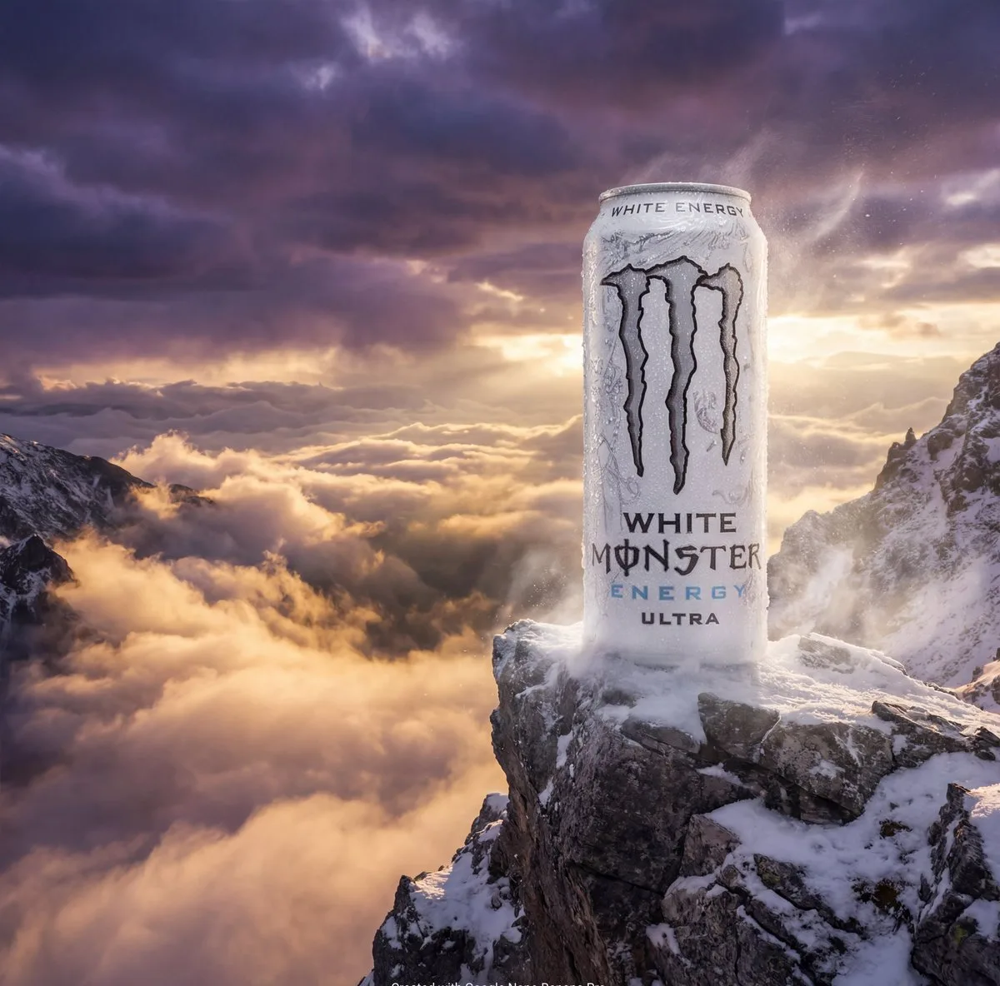

# K — by @ChillaiKalan__

[← Back to Community Examples](../../EXAMPLES.md) · Category: Product & Brand · Model: `Nano Banana`

<a href="https://x.com/ChillaiKalan__/status/2011457611724677533"></a>

Source: **[@ChillaiKalan__ on X](https://x.com/ChillaiKalan__/status/2011457611724677533)** · Creator: [K](https://x.com/ChillaiKalan__)

## Prompt

```text
Product ad style AI image on a mountain peak above clouds Created with Google Nano Banana Pro Prompt used: Ultra realistic cinematic image of a White Monster Energy Ultra can standing on a sharp mountain peak above a sea of clouds, extreme high altitude atmosphere, dramatic stormy sky, golden sunrise breaking through clouds, wind whipping snow and mist around the can, liquid condensation and ice particles on the surface, bold powerful presence, epic scale contrast
```

## Try it

Paste the prompt into **[vinano.ai](https://vinano.ai?utm_source=github&utm_medium=readme&utm_campaign=awesome-image-video-prompts-updating&utm_content=x-page-try)** to generate your own version.

> The image and prompt belong to @ChillaiKalan__ ([original post](https://x.com/ChillaiKalan__/status/2011457611724677533)) and are shown here with credit for reference. Creators can ask for changes or removal by opening an issue.
