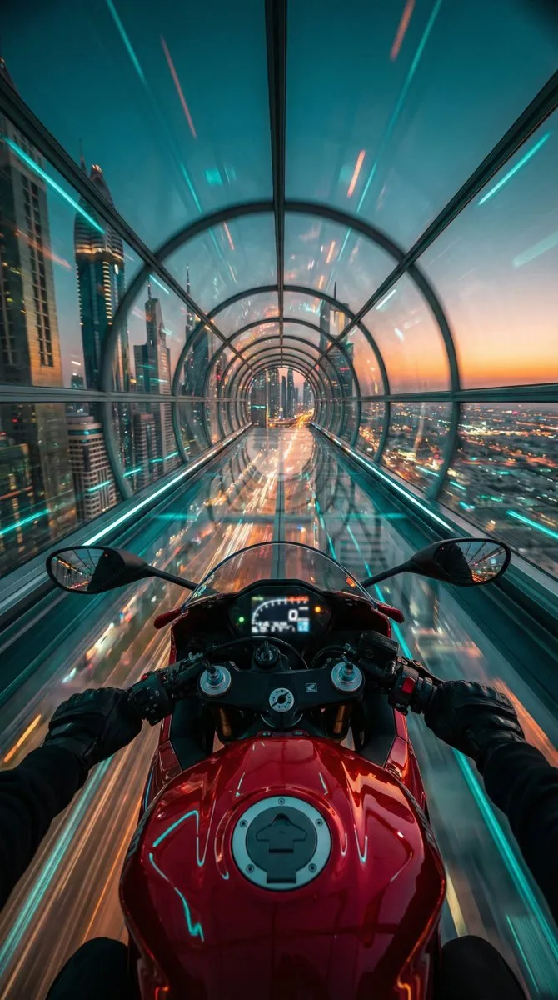

# Iqra Saifi — by @IqraSaifiii

[← Back to Community Examples](../../EXAMPLES.md) · Category: Illustration & 3D · Model: `Nano Banana`

<a href="https://x.com/IqraSaifiii/status/2011643251678462424"></a>

Source: **[@IqraSaifiii on X](https://x.com/IqraSaifiii/status/2011643251678462424)** · Creator: [Iqra Saifi](https://x.com/IqraSaifiii)

## Prompt

```text
"Red futuristic sport motorcycle (POV perspective)",
      "visible_elements": "Glossy red fuel tank with fuel cap, clip-on handlebars, black gloved hands gripping the grips, illuminated digital dashboard (slightly blurred)",
      "action": "Speeding at hyper-velocity through a suspended structure",
      "pose": "First-Person View (POV) / Rider's eye perspective looking slightly downward at the bike and forward into the horizon"
    },
    "environment": {
      "setting": "Transparent glass hyperloop tunnel / skyway",
      "location": "High altitude above a futuristic cyberpunk metropolis",
      "background_details": "Sprawling city grid with infinite street lights below, skyscrapers, motion-blurred light trails",
      "horizon": "Dusk/Twilight sky with a gradient of deep teal fading into a warm sunset orange strip"
    },
    "lighting_and_color": {
      "color_palette": "Cinematic Teal and Orange (Complementary colors)",
      "primary_tones": "Cyan/Turquoise glass reflections, Deep Red motorcycle paint, Golden/Orange horizon glow",
      "lighting_style": "High contrast, neon ambient lighting, specular highlights on the metal and glass surfaces"
    },
    "camera_technical": {
      "camera_angle": "Wide-angle POV (14mm to 16mm equivalent)",
      "focus": "Sharp focus on the motorcycle tank and handlebars, radial motion blur on the tunnel walls and city",
      "aperture": "f/2.8 (to capture low light details)",
      "shutter_speed": "1/30s (simulated drag shutter to create heavy motion blur effects on the surroundings)",
      "iso": "ISO 800",
      "composition": "Central symmetry, leading lines created by the tunnel structure converging at the center vanishing point"
    },
    "style_descriptors": [
      "Cyberpunk",
      "Synthwave aesthetic",
      "Hyper-realistic",
      "High velocity",
      "Futuristic",
      "Cinematic",
      "8k resolution",
      "Unreal Engine 5 render style"
```

## Try it

Paste the prompt into **[vinano.ai](https://vinano.ai?utm_source=github&utm_medium=readme&utm_campaign=awesome-image-video-prompts-updating&utm_content=x-page-try)** to generate your own version.

> The image and prompt belong to @IqraSaifiii ([original post](https://x.com/IqraSaifiii/status/2011643251678462424)) and are shown here with credit for reference. Creators can ask for changes or removal by opening an issue.
