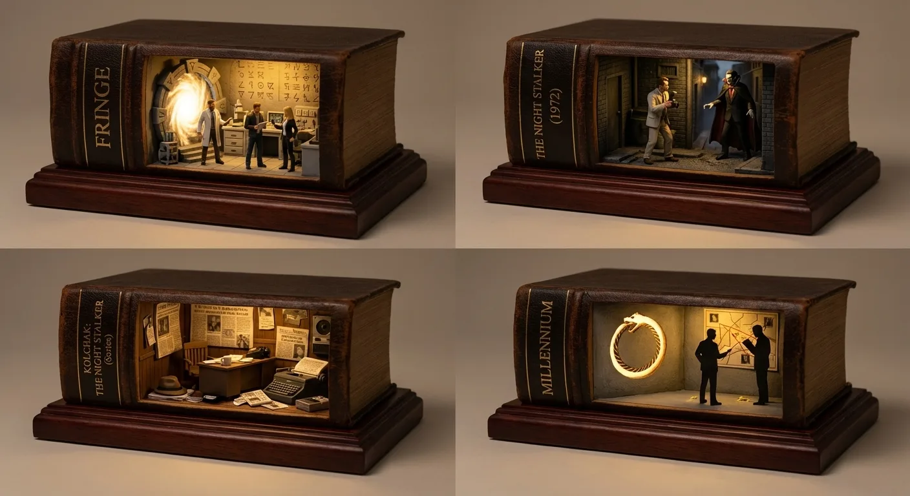

# Gadgetify — by @Gdgtify

[← Back to Examples from X](../../EXAMPLES.md) · Category: Illustration & 3D · Model: `Nano Banana`

<a href="https://x.com/Gdgtify/status/2009053185311203377"></a>

Original post: **[@Gdgtify on X](https://x.com/Gdgtify/status/2009053185311203377)** · Creator: [Gadgetify](https://x.com/Gdgtify)

## Prompt

```text
function recommend(x) { Determine type(x) (e.g. game, movie, book, or TV series) Role: world-class TV, book and movie expert  Analyze x's style, storyline, tone, every aspect and find 4 hidden gems in type (x) {} return: 2x2 grid carved book-block dioramas, each grid with antique leather-bound books hollowed and carved, warm reading-lamp glow from within, dark mahogany bases, ultra-realistic}   draw( recommend (X -Files);
```

## Try it

Paste the prompt into **[vinano.ai](https://vinano.ai?utm_source=github&utm_medium=readme&utm_campaign=awesome-image-video-prompts-updating&utm_content=x-page-try)** to generate your own version.

> The image and prompt belong to [@Gdgtify](https://x.com/Gdgtify) and are shown here with credit for reference. Creators can ask for changes or removal by opening an issue.
