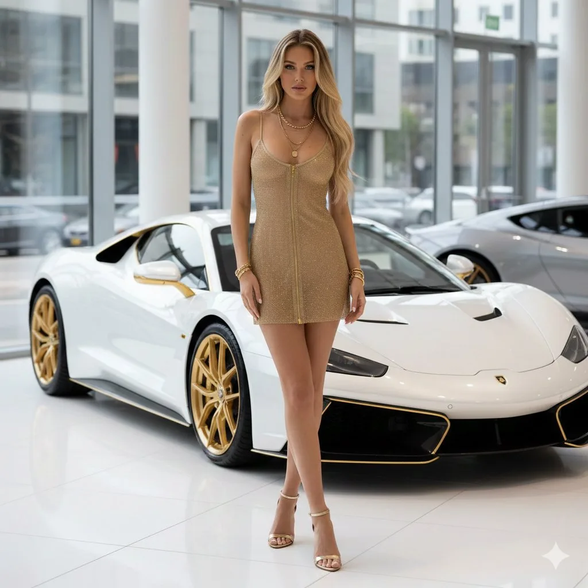

# Javeriya ✨ — by @JadoonKhan281

[← Back to Community Examples](../../EXAMPLES.md) · Category: Photography · Model: `Nano Banana`

<a href="https://x.com/JadoonKhan281/status/2011264537450987944"></a>

Source: **[@JadoonKhan281 on X](https://x.com/JadoonKhan281/status/2011264537450987944)** · Creator: [Javeriya ✨](https://x.com/JadoonKhan281)

## Prompt

```text
Gemini Nano Banana Pro 3.0  🍌

Prompt: 

{
  "image_description": {
    "subject": {
      "person": "A slender blonde woman with long hair, wearing a sheer, shimmering gold mesh mini dress with thin spaghetti straps and a vertical gold zipper detail.",
      "accessories": "Layered gold necklaces, gold bracelets, and metallic gold high-heeled sandals.",
      "pose": "Standing elegantly in front of a luxury car, legs crossed at the ankles, looking directly at the camera."
    },
    "vehicle": {
      "type": "A sleek, modern white supercar with gold accents.",
      "details": "High-gloss white paint, metallic gold rims, gold trim around the windows, and low-profile body styling."
    },
    "environment": {
      "location": "A bright, high-end luxury car showroom.",
      "lighting": "Clean, architectural indoor lighting with soft reflections on the polished white floor.",
      "background": "Large floor-to-ceiling glass windows showing other vehicles in a blurred outdoor setting."
    },
    "technical_style": {
      "composition": "Full-body shot, eye-level angle, centered subject.",
      "aesthetic": "High-fashion photography, photorealistic, sharp focus on the subject with a shallow depth of field (bokeh) in the background.",
      "color_palette": "Dominant white and gold, with neutral grey and black architectural tones."
    }
  }
}
```

## Try it

Paste the prompt into **[vinano.ai](https://vinano.ai?utm_source=github&utm_medium=readme&utm_campaign=awesome-image-video-prompts-updating&utm_content=x-page-try)** to generate your own version.

> The image and prompt belong to @JadoonKhan281 ([original post](https://x.com/JadoonKhan281/status/2011264537450987944)) and are shown here with credit for reference. Creators can ask for changes or removal by opening an issue.
