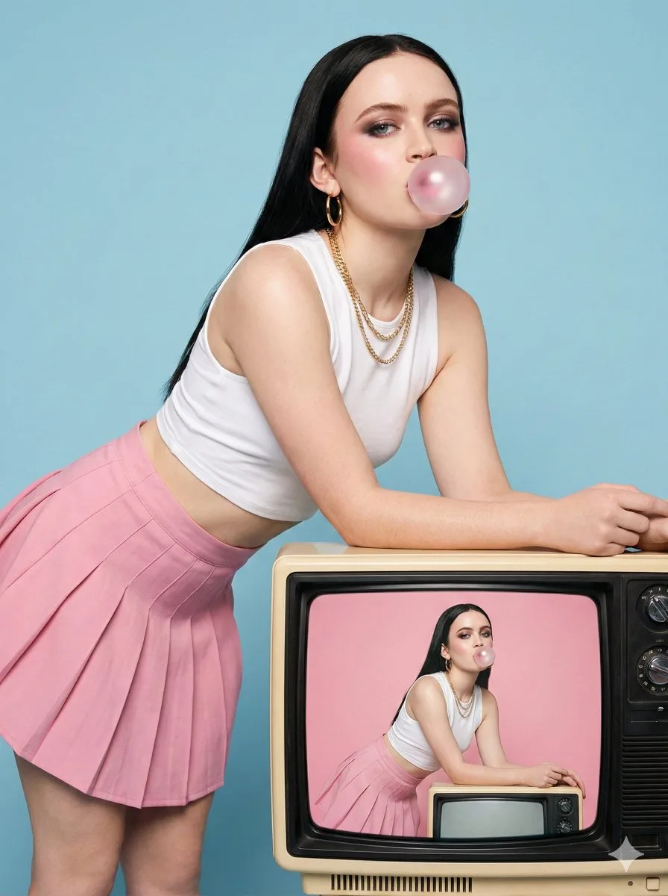

# ANKIT PATEL 🇮🇳 | AI — by @Ankit_patel211

[← Back to Examples from X](../../EXAMPLES.md) · Category: Photography · Model: `Nano Banana`

<a href="https://x.com/Ankit_patel211/status/2011431932622668165"></a>

Original post: **[@Ankit_patel211 on X](https://x.com/Ankit_patel211/status/2011431932622668165)** · Creator: [ANKIT PATEL 🇮🇳 | AI](https://x.com/Ankit_patel211)

## Prompt

```text
When pop aesthetics meet confidence… this is the vibe 💗📺

Would you dare to pull off this look? 💭✨

Gemini Nano Banana 🍌

{
  "type": "image_generation_prompt",
  "style": "ultra_realistic_fashion_editorial",
  "composition": {
    "camera": "studio photograph",
    "lighting": "clean studio lighting",
    "focus": "sharp focus",
    "resolution": "high resolution",
    "aesthetic": "modern pop",
    "color_palette": "vibrant pastels",
    "mood": "cinematic"
  },
  "background": {
    "type": "solid",
    "color": "pastel blue"
  },
  "subject": {
    "gender": "female",
    "appearance": {
      "hair": "long straight dark hair",
      "makeup": "glossy makeup with soft pink blush highlighted cheekbones bold eye makeup"
    },
    "attire": {
      "top": "fitted white sleeveless crop top",
      "bottom": "high waisted pink pleated mini skirt",
      "accessories": [
        "gold hoop earrings",
        "layered gold chain necklace"
      ]
    },
    "pose": {
      "position": "leaning forward",
      "interaction": "resting arms casually on a retro CRT television",
      "expression": "confident",
      "action": "blowing a translucent pink bubblegum bubble"
    }
  },
  "props": {
    "television": {
      "type": "retro CRT TV",
      "screen_content": "mirrored image of the same woman posing against a pink background",
      "effect": "dual reality visual concept"
    }
  },
  "style_tags": [
    "photorealistic",
    "fashion editorial",
    "cinematic composition",
    "creative concept",
    "pastel aesthetic"
  ]
}
```

## Try it

Paste the prompt into **[vinano.ai](https://vinano.ai?utm_source=github&utm_medium=readme&utm_campaign=awesome-image-video-prompts-updating&utm_content=x-page-try)** to generate your own version.

> The image and prompt belong to [@Ankit_patel211](https://x.com/Ankit_patel211) and are shown here with credit for reference. Creators can ask for changes or removal by opening an issue.
