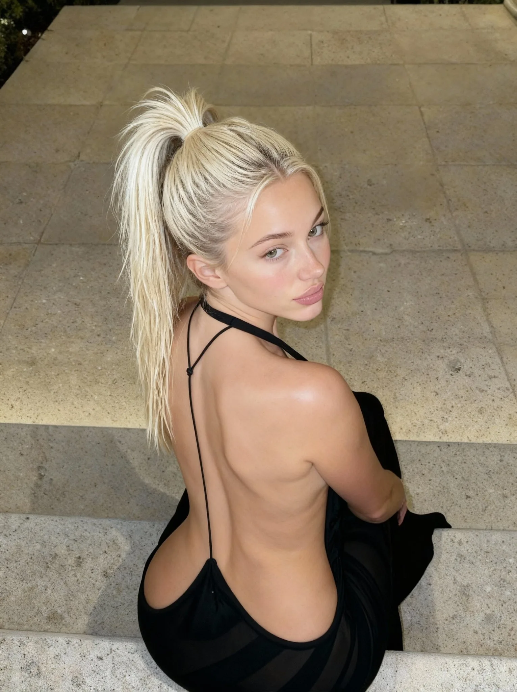

# Nilisty — by @nilisty

[← Back to Examples from X](../../EXAMPLES.md) · Category: Photography · Model: `Nano Banana`

<a href="https://x.com/nilisty/status/2009326322594795979"></a>

Original post: **[@nilisty on X](https://x.com/nilisty/status/2009326322594795979)** · Creator: [Nilisty](https://x.com/nilisty)

## Prompt

```text
the only thing i need to become a black swan is the nano banana pro.

{
  "scene_type": "nighttime flash portrait on stone steps, backless black dress, platinum ponytail, over-shoulder glance",

  "camera_perspective": {
    "pov": "photographer standing above and behind her",
    "angle": "shooting DOWN at her from above, she's looking UP and back",
    "distance": "medium shot - from hips up, back fully visible",
    "framing": "4:5 vertical, she fills lower portion, stone steps fill background",
    "height": "elevated above subject, creating looking-down angle"
  },

  "subject": {
    "action": "sitting on stone steps, back to camera, looking back over RIGHT shoulder up at photographer",
    
    "pose": {
      "overall_position": "SEATED on stone steps, back facing camera, twisted to look back",
      
      "body_angle": {
        "orientation": "back to camera - approximately 170 degrees away",
        "twist": "upper body twisted RIGHT to look back over shoulder",
        "seated": "sitting on step, weight on hips"
      },
      
      "back": {
        "visibility": "ENTIRE BACK EXPOSED - from shoulders to lower back",
        "state": "smooth, toned, tanned, the focal point",
        "spine": "visible line down center, thin dress string following it",
        "shoulder_blades": "visible, elegant muscle definition",
        "lower_back": "visible almost to top of butt, dress sits very low"
      },
      
      "upper_body": {
        "shoulders": "bare, tanned, smooth",
        "posture": "elegant, slight twist from looking back"
      },
      
      "arms": {
        "position": "in front of body, not visible from this angle",
        "hands": "possibly resting on steps or in lap, hidden from view"
      },
      
      "head_and_neck": {
        "turn": "looking back over RIGHT shoulder",
        "rotation": "significant twist - approximately 120 degrees from body",
        "chin": "slightly lifted, looking up at camera above",
        "neck": "elongated, elegant line, halter strap visible"
      },
      
      "overall": "classic over-shoulder seated pose, maximum back exposure"
    },
    
    "expression": {
      "eyes": {
        "color": "GREEN/HAZEL - striking, catching flash light",
        "direction": "looking UP at camera, direct eye contact",
        "state": "soft but focused, slightly intense, engaged",
        "energy": "confident, knowing, 'I know you're looking'"
      },
      "mouth": {
        "lips": "full, natural pink with slight gloss",
        "expression": "relaxed, soft slight pout, mouth closed",
        "state": "natural, subtle"
      },
      "brows": "natural, groomed, soft arch",
      "overall": "soft sultry confidence, the over-shoulder smolder"
    },

    "physical": {
      "age": "early 20s",
      
      "face": {
        "structure": "model features, high cheekbones, defined jaw, symmetrical",
        "shape": "oval, balanced",
        "skin": "flawless, glowing, tanned",
        "makeup": "natural/soft glam - subtle bronzer, soft brows, natural lip"
      },
      
      "body": {
        "type": "slim, toned, lean",
        "back": {
          "visibility": "FULLY EXPOSED - the main feature",
          "state": "smooth, toned, athletic definition",
          "tan": "even golden tan"
        },
        "shoulders": "narrow, feminine, toned",
        "skin_tone": "TANNED/BRONZED - golden, sun-kissed"
      },
      
      "hair": {
        "color": "PLATINUM BLONDE - very light, white-blonde, icy",
        "style": "HIGH PONYTAIL - messy, textured",
        "details": {
          "position": "high on crown of head",
          "texture": "messy, piece-y, textured waves",
          "volume": "voluminous, full, movement",
          "pieces": "some loose strands around face and nape"
        },
        "roots": "slightly darker roots visible, natural",
        "length": "long ponytail reaching mid-back",
        "state": "styled messy, intentionally undone, editorial texture",
        "vibe": "high fashion messy ponytail, effortful effortlessness"
      },
      
      "skin": {
        "tone": "golden tan, bronzed, warm",
        "state": "glowing, smooth, catching flash beautifully",
        "back": "flawless, even tan, highlight on shoulder blades"
      }
    },

    "outfit": {
      "dress": {
        "type": "BACKLESS HALTER DRESS/TOP",
        "color": "BLACK - solid, deep black",
        "material": {
          "type": "likely satin or similar",
          "finish": "slight sheen, elegant drape"
        },
        "construction": {
          "neckline": "HALTER - ties around neck",
          "neck_strap": "thin STRING tie at back of neck",
          "back": {
            "style": "COMPLETELY BACKLESS - extreme open back",
            "depth": "opens to LOWER BACK, almost to top of butt",
            "coverage": "essentially none on back"
          },
          "spine_detail": {
            "type": "single thin STRING running down spine",
            "path": "from neck tie down center of back to lower back/waist",
            "effect": "minimal connection, emphasizes naked back"
          },
          "front": "presumably covered, not visible in shot"
        },
        "fit": {
          "back": "completely open, skin fully exposed",
          "waist": "dress begins at very low back/upper hip",
          "skirt": "appears to flow from low waist"
        },
        "effect": "maximum skin showing while technically dressed"
      }
    }
  },

  "environment": {
    "setting": "outdoor STONE STEPS at NIGHT",
    "location_type": "possibly museum, monument, fancy building entrance, European architecture",
    
    "steps": {
      "material": "STONE - limestone or similar, large format",
      "color": "BEIGE/TAN/CREAM - warm neutral stone color",
      "texture": "smooth, weathered, some natural variation",
      "pattern": "large rectangular slabs",
      "state": "clean, architectural"
    },
    
    "background": {
      "main": "stone steps continuing up behind her",
      "foliage": "dark greenery/plants visible in upper left corner",
      "depth": "steps create leading lines toward camera"
    },
    
    "lighting": {
      "type": "CAMERA FLASH - direct, harsh, nighttime",
      "time": "NIGHT - dark ambient, flash illuminating subject",
      "quality": "hard flash light, typical night photography",
      "effect": {
        "on_subject": "brightly lit, glowing skin, highlights on back",
        "on_background": "stone steps illuminated, slight falloff",
        "shadows": "minimal on subject (front-lit), some behind"
      },
      "contrast": "flash-lit subject against darker night environment",
      "color_temperature": "flash is neutral/cool, skin reads warm"
    },
    
    "atmosphere": "nighttime outdoor, European/architectural, date night vibes"
  },

  "color_story": {
    "palette_name": "Blonde on Black on Stone at Night",
    
    "dominant": {
      "beige_stone": "steps/background - warm neutral, 50%",
      "black_dress": "her outfit - deep black, contrast"
    },
    
    "subject_colors": {
      "platinum_hair": "very light blonde, almost white - bright against dark",
      "tanned_skin": "golden bronze - warm, glowing",
      "green_eyes": "striking color pop"
    },
    
    "contrast": {
      "hair_vs_dress": "platinum blonde against black = high contrast",
      "skin_vs_dress": "tan skin against black = beautiful definition",
      "subject_vs_background": "lit subject against darker surroundings"
    },
    
    "temperature": "warm tones (skin, stone) with cool flash light"
  },

  "photography_technical": {
    "type": "flash portrait, nighttime outdoor",
    "lighting": "ON-CAMERA or OFF-CAMERA FLASH",
    
    "aspect_ratio": "4:5 vertical",
    
    "composition": {
      "subject": "lower center of frame, looking up",
      "background": "steps filling upper portion",
      "angle": "shot from above looking down",
      "leading_lines": "step edges lead to subject"
    },
    
    "focus": {
      "focal_point": "sharp on face and back",
      "depth_of_field": "moderate, background slightly soft"
    },
    
    "exposure": {
      "subject": "well-exposed from flash",
      "ambient": "darker, night time",
      "style": "flash-forward night photography"
    }
  },

  "narrative": {
    "story": "night out, sitting on steps outside fancy venue, someone captures the moment from above",
    "mood": "confident, elegant, 'caught looking back' moment",
    "context": "date night? event? European vacation? the dress is the story"
  },

  "vibe": {
    "core": "platinum ponytail in backless black dress, sitting on stone steps at night, flash photo looking back",
    "energy": "elegant confidence, old money night out, main character moment",
    "mood": "sophisticated, sultry, intentional",
    "aesthetic": "European night out, editorial flash, fashion moment",
    "temperature": "warm skin against cool night",
    "caption_energy": "'🖤' or location tag or 'night' or no caption"
  },

  "what_makes_it_hit": {
    "the_back": "fully exposed back is THE shot - skin is the star",
    "the_dress_detail": "thin string down spine = minimal coverage, maximum impact",
    "the_over_shoulder": "classic pose, direct eye contact, engaging",
    "the_ponytail": "high messy platinum = editorial, effortless glamour",
    "the_tan": "golden skin against black dress = beautiful contrast",
    "the_stone_steps": "architectural setting elevates from basic to editorial",
    "the_flash": "night flash aesthetic = raw, real, elevated party photo",
    "the_angle": "shot from above = interesting perspective, shows full back"
  },

  "recreation_critical_requirements": {
    "MUST_HAVE": [
      "PLATINUM BLONDE hair - very light, white-blonde",
      "HIGH MESSY PONYTAIL - textured, voluminous, pieces escaping",
      "GREEN/HAZEL eyes",
      "TANNED/BRONZED skin - golden, glowing",
      "BLACK BACKLESS HALTER DRESS/TOP",
      "VERY LOW BACK - open to lower back, almost to butt",
      "THIN STRING tie at neck (halter)",
      "THIN STRING running down SPINE from neck to lower back",
      "ENTIRE BACK EXPOSED - shoulders to lower back visible",
      "SEATED on STONE STEPS - beige/tan colored",
      "Back to camera, looking over RIGHT SHOULDER up at camera",
      "NIGHTTIME setting",
      "FLASH PHOTOGRAPHY lighting",
      "Shot from ABOVE looking down at her",
      "4:5 vertical aspect ratio"
    ],
    
    "pose_exact": "seated on steps, back to camera, looking over right shoulder up at photographer above",
    "dress_exact": "black halter with thin string neck tie and single thin string down exposed spine, extremely low open back",
    "hair_exact": "platinum blonde high messy ponytail, voluminous, textured, pieces loose",
    "lighting_exact": "direct flash at night, subject illuminated against darker surroundings",
    "setting_exact": "outdoor stone/limestone steps, architectural, nighttime"
  }
}
```

## Try it

Paste the prompt into **[vinano.ai](https://vinano.ai?utm_source=github&utm_medium=readme&utm_campaign=awesome-image-video-prompts-updating&utm_content=x-page-try)** to generate your own version.

> The image and prompt belong to [@nilisty](https://x.com/nilisty) and are shown here with credit for reference. Creators can ask for changes or removal by opening an issue.
