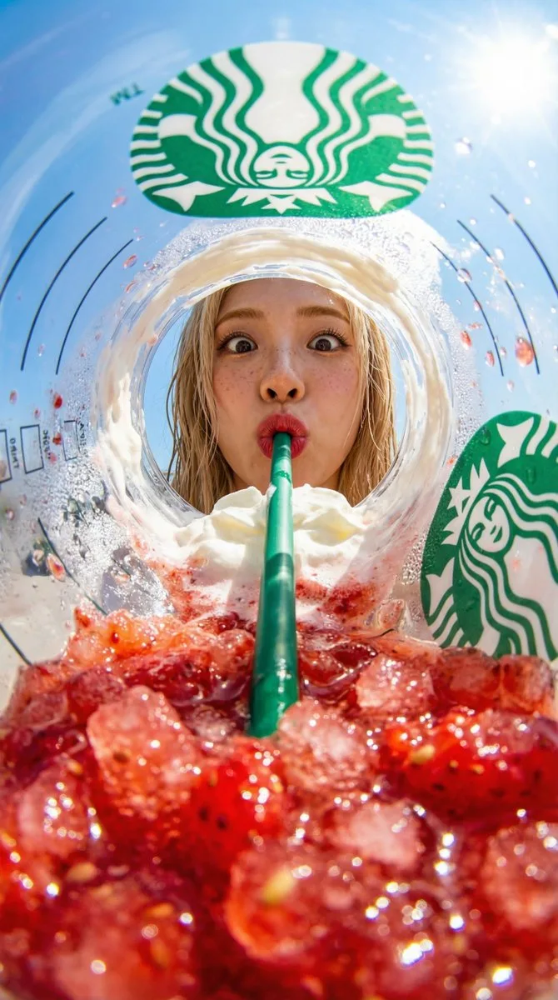

# Vigo Zhao — by @VigoCreativeAI

[← Back to Examples from X](../../EXAMPLES.md) · Category: Poster Design · Model: `Nano Banana`

<a href="https://x.com/VigoCreativeAI/status/2041163046874382357"></a>

Original post: **[@VigoCreativeAI on X](https://x.com/VigoCreativeAI/status/2041163046874382357)** · Creator: [Vigo Zhao](https://x.com/VigoCreativeAI)

## Prompt

```text
{
  "prompt": "View from inside a Starbucks strawberry frappuccino cup looking up, fisheye lens extreme distortion, worm's eye perspective, crushed strawberry ice macro foreground with glistening bokeh highlights, one single continuous green straw passing through the entire frame from top to bottom connecting lips to ice, person peering down from above through cup opening with wide-eyed excited expression lips pursed on straw top, whipped cream layer, Starbucks logo visible on cup wall, clear blue sky background through opening, high saturation red strawberry vs green straw complementary colors, bright summer daylight, hyper-realistic commercial photography",
  "negative_prompt": "two straws, double straw, multiple straws, broken straw, separated straw, disconnected straw, flat lay, normal perspective, dull colors, deformed face, low saturation, ugly, extra limbs, woman, girl, female",
  "character_reference": {
    "upload": true,
    "control_weight": 0.95,
    "description": "maintain face and identity from reference image, male person, front-facing, slightly downward gaze, wide-eyed excited expression, lips pursed on straw"
  },
  "parameters": {
    "aspect_ratio": "9:16",
    "style_strength": 0.9,
    "composition_reference": "inside-cup fisheye upward shot, face centered in cup opening, single straw runs continuously from person lips down through whipped cream into crushed ice"
  }
}
```

## Try it

Paste the prompt into **[vinano.ai](https://vinano.ai?utm_source=github&utm_medium=readme&utm_campaign=awesome-image-video-prompts-updating&utm_content=x-page-try)** to generate your own version.

> The image and prompt belong to [@VigoCreativeAI](https://x.com/VigoCreativeAI) and are shown here with credit for reference. Creators can ask for changes or removal by opening an issue.
