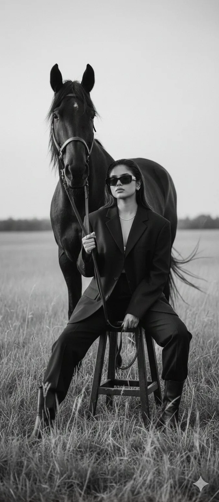

# Dr. Samia — by @oye_samia

[← Back to Examples from X](../../EXAMPLES.md) · Category: Photography · Model: `Nano Banana`

<a href="https://x.com/oye_samia/status/2010284583028486414"></a>

Original post: **[@oye_samia on X](https://x.com/oye_samia/status/2010284583028486414)** · Creator: [Dr. Samia](https://x.com/oye_samia)

## Prompt

```text
Don’t watch the clock; do what it does. Keep going.

Gemini Nano Banana Pro + Grok imagine.

Prompt ⤵️ 

Create a cinematic black‑and‑white editorial fashion photograph featuring a young woman sitting confidently on a simple wooden stool in an open, slightly wild grassy field, with a powerful black horse standing closely behind her. She holds the horse’s reins loosely in one hand, exuding quiet control. The woman wears a dark oversized luxury blazer, straight‑cut trousers, leather boots, minimal jewelry, sunglasses, and has her head slightly tilted down with a calm, introspective, dominant yet relaxed expression.

Use a minimalist composition with strong negative space, high‑contrast monochrome tones, and soft natural daylight. Apply a shallow depth of field to blur the empty rural landscape (no buildings, only textured grass with distant blur). Capture an editorial luxury fashion vibe with a moody, poetic atmosphere, sharp details, subtle film grain texture, and dramatic shadows in a Vogue‑style photography style. Shoot with an 85mm lens for cinematic realism.
```

## Try it

Paste the prompt into **[vinano.ai](https://vinano.ai?utm_source=github&utm_medium=readme&utm_campaign=awesome-image-video-prompts-updating&utm_content=x-page-try)** to generate your own version.

> The image and prompt belong to [@oye_samia](https://x.com/oye_samia) and are shown here with credit for reference. Creators can ask for changes or removal by opening an issue.
