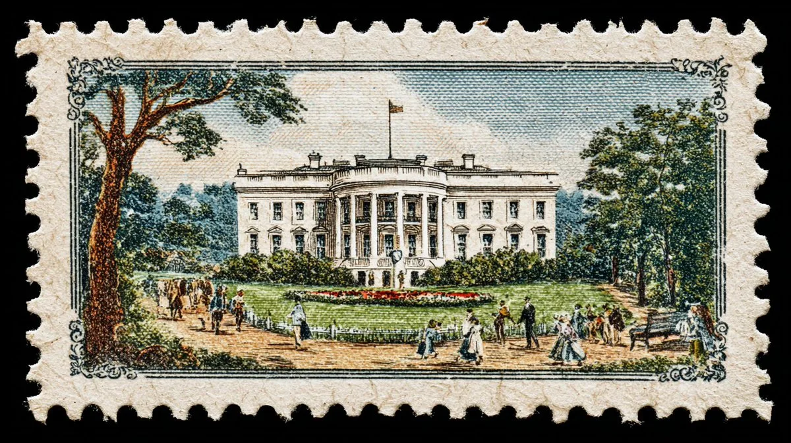

# Pierrick Chevallier | IA — by @CharaspowerAI

[← Back to Examples from X](../../EXAMPLES.md) · Category: Illustration & 3D · Model: `Nano Banana`

<a href="https://x.com/CharaspowerAI/status/2041191723892707663"></a>

Original post: **[@CharaspowerAI on X](https://x.com/CharaspowerAI/status/2041191723892707663)** · Creator: [Pierrick Chevallier | IA](https://x.com/CharaspowerAI)

## Prompt

```text
a vintage postage stamp depicting [iconic monument of a capital with people interacting in the scene]. 
Pastel colors, extremely thin black border all around it, simple background, paper texture, high details
```

## Try it

Paste the prompt into **[vinano.ai](https://vinano.ai?utm_source=github&utm_medium=readme&utm_campaign=awesome-image-video-prompts-updating&utm_content=x-page-try)** to generate your own version.

> The image and prompt belong to [@CharaspowerAI](https://x.com/CharaspowerAI) and are shown here with credit for reference. Creators can ask for changes or removal by opening an issue.
