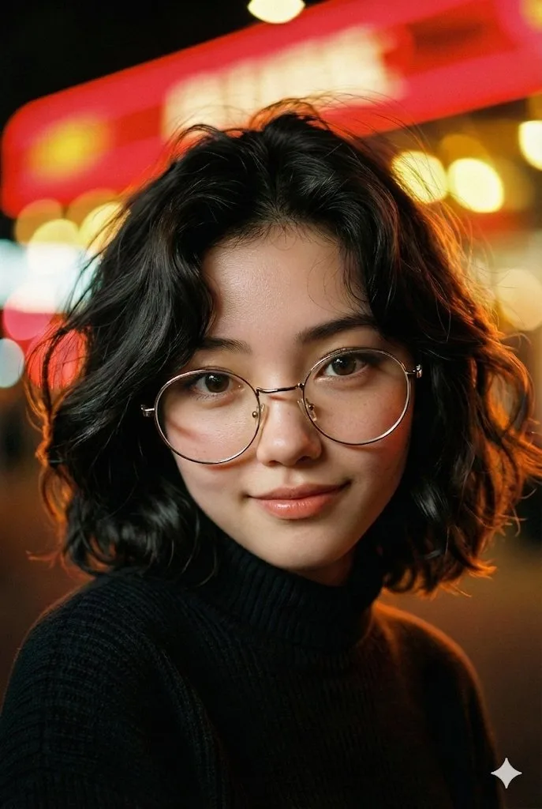

# Minhaa — by @tabu_8114

[← Back to Community Examples](../../EXAMPLES.md) · Category: Photography · Model: `Nano Banana`

<a href="https://x.com/tabu_8114/status/2008543000750948734"></a>

Source: **[@tabu_8114 on X](https://x.com/tabu_8114/status/2008543000750948734)** · Creator: [Minhaa](https://x.com/tabu_8114)

## Prompt

```text
Gemini Nano Banana Pro

Prompt:

{ "image_type": "photograph", "genre": "casual portrait", "composition": { "framing": "close-up, chest-up portrait", "angle": "slightly tilted, camera held above eye level and angled downward", "orientation": "portrait with diagonal tilt", "subject_placement": "subject positioned slightly off-center, face occupying left-middle area", "crop": "tight crop with partial arm visible in foreground" }, "subject": { "count": 1, "gender_presentation": "female-presenting", "age_range": "young adult", "facial_features": { "skin_tone": "light, neutral-warm", "complexion": "clear, smooth with natural texture", "eyes": "light green/gray, almond-shaped", "eyebrows": "medium thickness, natural shape", "nose": "straight, small to medium", "lips": "natural pink, closed-mouth slight smile" }, "hair": { "color": "dark brown", "length": "long", "style": "straight, tucked behind ear on one side", "part": "slight side part" }, "expression": "soft, relaxed, friendly", "gaze": "looking directly into camera", "accessories": [ "small silver stud earrings" ], "clothing": { "type": "sports jersey", "fit": "loose athletic fit", "color": "white with black accents", "details": [ "black collar trim", "black logos and text", "shield-style emblem on chest", "large curved black graphic text" ] } }, "lighting": { "type": "natural light", "direction": "side/front light from window", "quality": "soft, diffused", "shadows": "minimal, gentle", "highlights": "subtle skin highlights on cheek and forehead" }, "color_palette": { "dominant_colors": [ "white", "soft gray", "black" ], "accent_colors": [ "natural skin tones", "brown hair" ], "overall_tone": "neutral, clean, airy" }, "background": { "setting": "indoor", "elements": [ "sheer white curtains", "window frame partially visible" ], "depth_of_field": "moderate, background slightly soft but recognizable", "style": "minimalist, uncluttered" }, "technical_details": { "camera_type": "DSLR", "focal_length_equivalent": "wide-angle selfie lens", "resolution": "high", "sharpness": "sharp focus on face", "noise": "minimal", "white_balance": "neutral" }, "artistic_style": { "aesthetic": "clean, natural, lifestyle", "retouching": "very minimal, natural skin texture preserved", "mood": "calm, approachable, casual" }, "typography": { "presence": true, "location": "on jersey", "style": "bold sans-serif sports branding", "color": "black", "readability": "partially visible due to crop" } }
```

## Try it

Paste the prompt into **[vinano.ai](https://vinano.ai?utm_source=github&utm_medium=readme&utm_campaign=awesome-image-video-prompts-updating&utm_content=x-page-try)** to generate your own version.

> The image and prompt belong to @tabu_8114 ([original post](https://x.com/tabu_8114/status/2008543000750948734)) and are shown here with credit for reference. Creators can ask for changes or removal by opening an issue.
