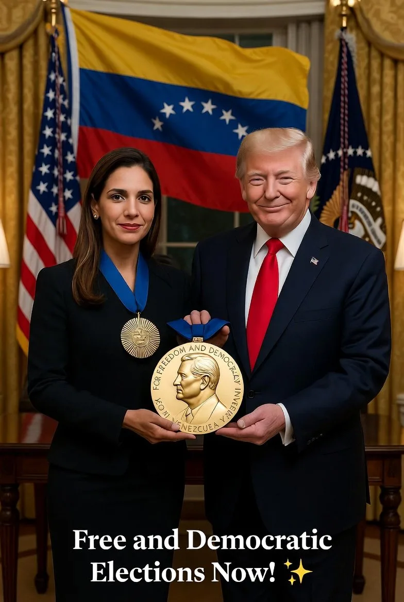

# Sindhu Sherni🦁 — by @SindhuK66662473

[← Back to Community Examples](../../EXAMPLES.md) · Category: Photography · Model: `Nano Banana`

<a href="https://x.com/SindhuK66662473/status/2012020162195857782"></a>

Source: **[@SindhuK66662473 on X](https://x.com/SindhuK66662473/status/2012020162195857782)** · Creator: [Sindhu Sherni🦁](https://x.com/SindhuK66662473)

## Prompt

```text
Cinematic, ultra-realistic scene depicting Venezuelan opposition leader María Corina Machado presenting her Nobel Peace Prize medal to Donald Trump. Machado stands with a calm yet determined expression, holding the Nobel medal as a symbol of hope and democracy. Trump receives it thoughtfully, set against a dignified indoor setting. In the background, subtle symbolism appears: softly blurred US and Venezuelan flags, a faint glow of light symbolizing freedom, and a distant crowd suggesting democratic aspirations. Mood is serious, historic, and hopeful. Professional lighting, shallow depth of field, high detail, photo-journalistic realism.”
```

## Try it

Paste the prompt into **[vinano.ai](https://vinano.ai?utm_source=github&utm_medium=readme&utm_campaign=awesome-image-video-prompts-updating&utm_content=x-page-try)** to generate your own version.

> The image and prompt belong to @SindhuK66662473 ([original post](https://x.com/SindhuK66662473/status/2012020162195857782)) and are shown here with credit for reference. Creators can ask for changes or removal by opening an issue.
