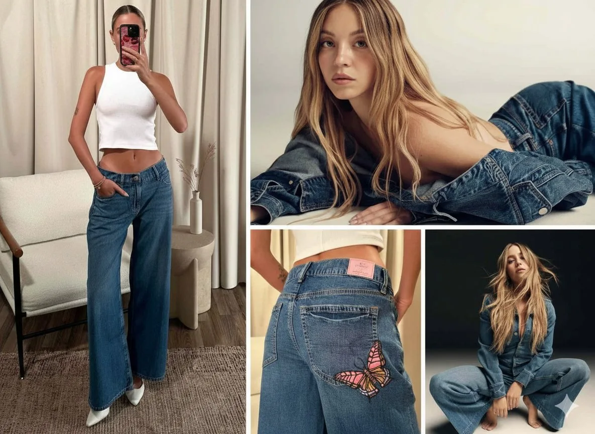

# Bahar azam — by @BaharAzamm561

[← Back to Community Examples](../../EXAMPLES.md) · Category: Photography · Model: `Nano Banana`

<a href="https://x.com/BaharAzamm561/status/2011034968127057975"></a>

Source: **[@BaharAzamm561 on X](https://x.com/BaharAzamm561/status/2011034968127057975)** · Creator: [Bahar azam](https://x.com/BaharAzamm561)

## Prompt

```text
{
  "file_metadata": {
    "filename": "sydney_sweeney_ae_campaign_collage.jpg",
    "category": "High-End Fashion Photography",
    "project": "American Eagle Denim Collection 2024",
    "talent": "Sydney Sweeney"
  },
  "visual_composition": {
    "layout_type": "4-Panel Asymmetrical Collage",
    "color_palette": {
      "primary": "Indigo Blue (Denim Wash)",
      "secondary": "Creamy White (Top & Background)",
      "accent": "Dusty Rose / Blush Pink (Butterfly Detail)",
      "vibe": "Warm, Nostalgic, Y2K Grunge"
    },
    "lighting": "Soft diffused studio light with warm highlight tones",
    "aesthetic_tags": ["Vintage Revival", "Baggy Silhouette", "Main Character Energy"]
  },
  "detailed_frame_analysis": {
    "panel_1_left": {
      "focus": "Full Body Silhouette",
      "pose": "Mirror selfie aesthetic with a slight lean",
      "outfit_details": {
        "top": "White ribbed racerback crop tank",
        "bottom": "Extra wide-leg low-rise indigo jeans",
        "footwear": "White pointed-toe stilettos",
        "accessories": "Delicate gold bracelets and a floral-patterned phone case"
      }
    },
    "panel_2_top_right": {
      "focus": "Beauty & Expression",
      "pose": "Reclined, looking directly into the lens",
      "styling": "Oversized denim jacket draped off-the-shoulder",
      "hair": "Center-parted blonde waves with natural volume",
      "makeup": "Minimalist 'Clean Girl' look with dewy skin"
    },
    "panel_3_bottom_center": {
      "focus": "Product Detail & Embroidery",
      "subject": "Denim back pocket",
      "features": [
        "Intricate pink and orange butterfly embroidery",
        "Pink leather brand patch with American Eagle logo",
        "Contrast stitching on heavy-duty denim fabric"
      ]
    },
    "panel_4_bottom_right": {
      "focus": "Style Statement",
      "pose": "Symmetrical crouched pose on a dark background",
      "outfit": "Full denim jumpsuit/set (Double Denim)",
      "mood": "Bold and confident"
    }
  },
  "garment_dna": {
    "fabric": "Non-stretch, premium weight cotton denim",
    "wash": "Medium indigo stone-wash with vintage fading",
    "fit_profile": "Loose, oversized, baggy, and low-slung waist"
  },
  "marketing_tags": {
    "target_audience": "Gen-Z and Millennial Fashion Seekers",
    "trending_hashtags": ["
    "alt_text": "A fashion collage of Sydney Sweeney for American Eagle showcasing wide-leg jeans with butterfly embroidery and a white crop top in various professional poses."
  }
}
```

## Try it

Paste the prompt into **[vinano.ai](https://vinano.ai?utm_source=github&utm_medium=readme&utm_campaign=awesome-image-video-prompts-updating&utm_content=x-page-try)** to generate your own version.

> The image and prompt belong to @BaharAzamm561 ([original post](https://x.com/BaharAzamm561/status/2011034968127057975)) and are shown here with credit for reference. Creators can ask for changes or removal by opening an issue.
