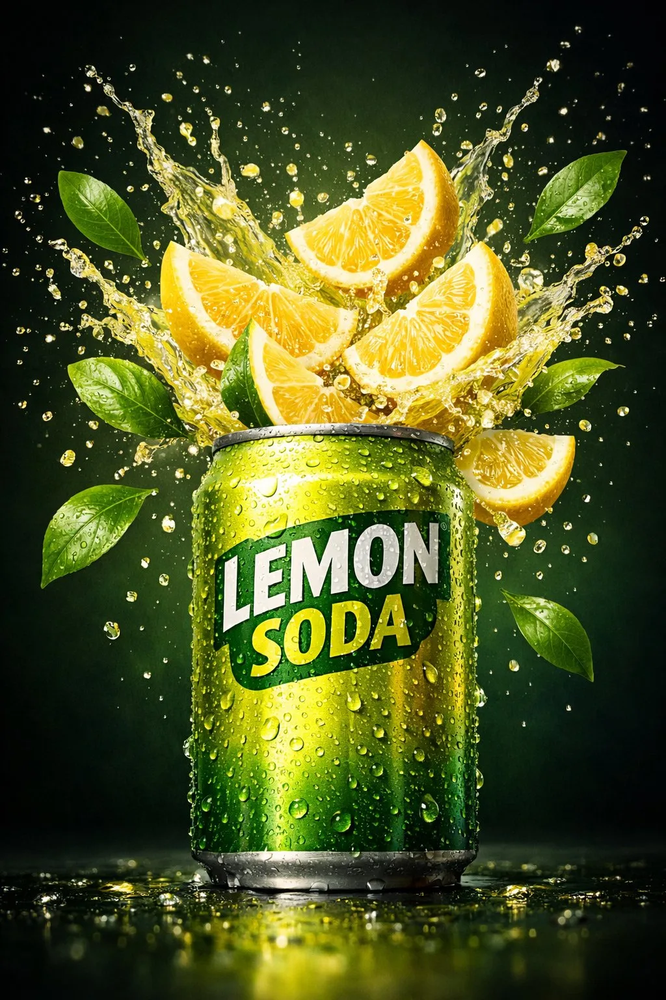

# K — by @ChillaiKalan__

[← Back to Examples from X](../../EXAMPLES.md) · Category: Product & Brand · Model: `Nano Banana`

<a href="https://x.com/ChillaiKalan__/status/2010358364048597154"></a>

Original post: **[@ChillaiKalan__ on X](https://x.com/ChillaiKalan__/status/2010358364048597154)** · Creator: [K](https://x.com/ChillaiKalan__)

## Prompt

```text
A hyper-realistic commercial product shot of a
lemon soda can, with fresh lemon slices bursting
out of the can in a dynamic splash. The can is
covered in cold condensation droplets, glossy
metallic texture, vibrant yellow-green color palette.
Lemon wedges and citrus juice splashes frozen
mid-air, ultra-detailed lemon pulp visible. Fresh
green leaves floating around, dark green gradient
background, soft studio lighting, dramatic high-
lights, shallow depth of field, cinematic advertising
style, ultra-sharp focus, 8K resolution, photorealis-
tic, premium beverage ad. img
```

## Try it

Paste the prompt into **[vinano.ai](https://vinano.ai?utm_source=github&utm_medium=readme&utm_campaign=awesome-image-video-prompts-updating&utm_content=x-page-try)** to generate your own version.

> The image and prompt belong to [@ChillaiKalan__](https://x.com/ChillaiKalan__) and are shown here with credit for reference. Creators can ask for changes or removal by opening an issue.
