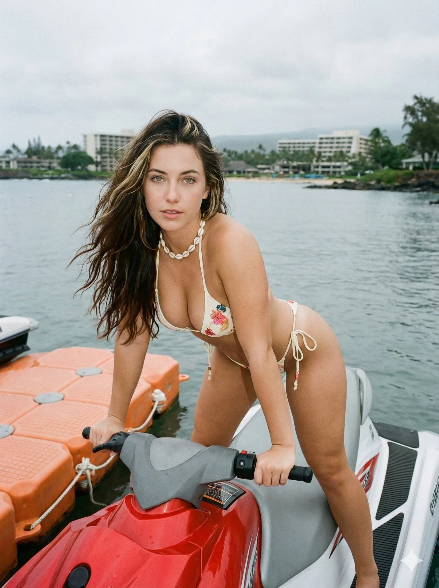

# Jennie — by @PurelyJennie

[← Back to Examples from X](../../EXAMPLES.md) · Category: Photography · Model: `Nano Banana`

<a href="https://x.com/PurelyJennie/status/2009333419218554971"></a>

Original post: **[@PurelyJennie on X](https://x.com/PurelyJennie/status/2009333419218554971)** · Creator: [Jennie](https://x.com/PurelyJennie)

## Prompt

```text
Which pose do you like more? 🤣

Generated with Nano Banana Pro:

Prompt:
{
  "subject": {
    "demographics": {
      "age": "early 20s",
      "gender": "female",
      "ethnicity": "Caucasian"
    },
    "hair": {
      "color": "dark brown with blonde highlights",
      "style": "long, loose, slightly windswept, falling over shoulders",
      "texture": "natural, fine strands"
    },
    "face": {
      "shape": "oval",
      "eyes": "light green, almond-shaped, direct gaze at camera",
      "nose": "straight bridge",
      "lips": "full, natural color, slight pout",
      "skin_texture": "natural, minimal makeup, slight tan"
    },
    "body_proportions": {
      "build": "hyper-curvy athletic, extreme hourglass silhouette",
      "bust": "voluminous, heavy, naturally weighted with clear gravity effect, projecting outward, creating tension on the thin bikini straps",
      "waist": "extraordinarily narrow, cinched, high-definition abdominal tone, visible vertical 'Ab crack' line",
      "hips": "wide, flared, significantly wider than the ribcage and shoulders",
      "legs": "thick, muscular thighs with toned definition, wide stance",
      "skin_details": "smooth even tan, realistic skin folds at the hip-waist junction, subtle goosebumps from the cold environment"
    },
    "attire": {
      "item": "string bikini",
      "color": "cream with lighter flower designs",
      "material": "nylon swimwear fabric",
      "top_details": "triangle cups, halter neck tie, back tie",
      "bottom_details": "matching high-cut string bikini bottoms, tie-side closure, positioned high on the iliac crest to elongate the torso"
    },
    "accessories": {
      "neck": "short conch shell necklace"
    }
  },
  "pose": {
    "type": "seated leaning forward",
    "location": "on personal watercraft",
    "orientation": "body angled slightly right, face turned frontal",
    "arms": {
      "position": "resting on handlebars",
      "hands": "holding grips"
    },
    "legs": {
      "position": "straddling seat",
      "left_leg": "bent, resting on footwell",
      "right_leg": "bent, obscured"
    },
    "torso": {
      "posture": "leaning forward over handlebars"
    }
  },
  "setting": {
    "location": "coastal water with floating dock",
    "foreground": "red/white Yamaha personal watercraft, orange plastic floating dock",
    "background": "calm water, distant shoreline with resort hotels and trees under overcast sky",
    "props": "other personal watercraft partially visible",
    "clutter": "natural elements"
  },
  "camera": {
    "shot_type": "medium shot",
    "angle": "eye-level",
    "framing": "subject centered",
    "focal_length": "35mm",
    "depth_of_field": "moderate, background slightly soft",
    "perspective": "straight on",
    "aspect_ratio": "3:4"
  },
  "lighting": {
    "source": "overcast daylight",
    "direction": "diffused from above",
    "quality": "soft, even, no harsh shadows",
    "highlights": "subtle sheen on water and fiberglass",
    "shadows": "soft, barely defined",
    "color_temperature": "cool daylight (6000K)"
  },
  "mood_and_expression": {
    "emotion": "calm, direct, slightly alluring",
    "gaze": "direct eye contact with camera",
    "atmosphere": "casual, overcast, aquatic"
  },
  "style_and_realism": {
    "aesthetic": "candid lifestyle photograph, raw, unfiltered",
    "realism_level": "photorealistic, natural film grain",
    "skin_rendering": "natural texture, no airbrushing",
    "imperfections": "natural wind in hair, water droplets on PWC"
  },
  "colors_and_tone": {
    "palette": "muted greens, blues, grays, natural skin tones",
    "contrast": "medium",
    "saturation": "natural, slightly desaturated due to overcast light",
    "white_balance": "cool daylight"
  },
  "technical_details": {
    "resolution": "high resolution",
    "sharpness": "focus on subject's face and PWC details",
    "noise": "visible film grain"
  }
}
```

## Try it

Paste the prompt into **[vinano.ai](https://vinano.ai?utm_source=github&utm_medium=readme&utm_campaign=awesome-image-video-prompts-updating&utm_content=x-page-try)** to generate your own version.

> The image and prompt belong to [@PurelyJennie](https://x.com/PurelyJennie) and are shown here with credit for reference. Creators can ask for changes or removal by opening an issue.
