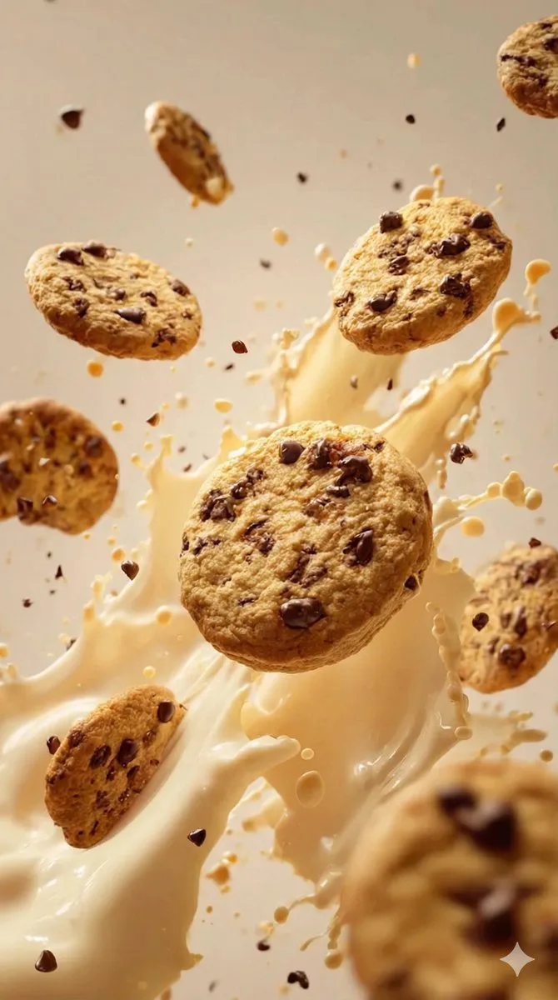

# The Newz 2.0 — by @TheNewz_816

[← Back to Examples from X](../../EXAMPLES.md) · Category: Food & Drink · Model: `Nano Banana`

<a href="https://x.com/TheNewz_816/status/2011044123818549711"></a>

Original post: **[@TheNewz_816 on X](https://x.com/TheNewz_816/status/2011044123818549711)** · Creator: [The Newz 2.0](https://x.com/TheNewz_816)

## Prompt

```text
{
  "production_manifest": {
    "metadata": {
      "series_id": "CIN-FOOD-2025",
      "aspect_ratio": "9:16",
      "resolution_target": "8k_uhd"
    },
    "technical_stack": {
      "hardware": {
        "camera": "ARRI Alexa 65",
        "lens_profile": "Large format cinematic prime"
      },
      "film_emulation": {
        "stock": "Kodak Portra 400",
        "characteristics": ["Fine grain", "Natural skin tones", "Warm highlights"]
      },
      "lighting_rig": {
        "style": "Cinematic soft glow",
        "atmosphere": "Timeless indoor",
        "diffusion": "High"
      }
    },
    "artistic_direction": {
      "visionary_style": "Greta Gerwig",
      "composition_rule": "Graphic centered symmetry",
      "physics_engine": "Suspended animation / Zero gravity",
      "background_specification": "Flat off-white / Studio bone"
    },
    "variant_registry": [
      {
        "id": "VAR-001",
        "flavor_profile": "Dark Chocolate Chip & Oat",
        "tonal_emotion": "Playful, cheeky yet chic",
        "ingredients": {
          "primary_solids": ["Dark chocolate chip cookies"],
          "fluid_fx": ["Oat milk splash"],
          "debris": ["Cookie crumbs"]
        }
      },
      {
        "id": "VAR-002",
        "flavor_profile": "Red Velvet",
        "tonal_emotion": "Bold, playful chic",
        "ingredients": {
          "primary_solids": ["Red velvet cake pieces"],
          "fluid_fx": ["Cream cheese frosting swirls"],
          "debris": ["Cocoa dust", "Fine red cake crumbs"]
        }
      },
      {
        "id": "VAR-003",
        "flavor_profile": "Pistachio Macaron",
        "tonal_emotion": "Refined, playful chic",
        "ingredients": {
          "primary_solids": ["Pistachio macarons"],
          "fluid_fx": ["Cream filling swirls"],
          "debris": ["Crushed pistachio nuts"]
        }
      },
      {
        "id": "VAR-004",
        "flavor_profile": "Strawberry Shortcake",
        "tonal_emotion": "Sweet, playful yet chic",
        "ingredients": {
          "primary_solids": ["Fresh strawberry slices"],
          "fluid_fx": ["Whipped cream swirls"],
          "debris": ["Shortcake biscuit crumbs"]
        }
      }
    ]
  }
}
```

## Try it

Paste the prompt into **[vinano.ai](https://vinano.ai?utm_source=github&utm_medium=readme&utm_campaign=awesome-image-video-prompts-updating&utm_content=x-page-try)** to generate your own version.

> The image and prompt belong to [@TheNewz_816](https://x.com/TheNewz_816) and are shown here with credit for reference. Creators can ask for changes or removal by opening an issue.
