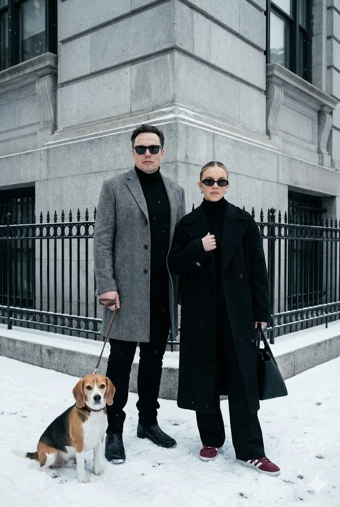

# yusra. — by @chatgptpaglu

[← Back to Community Examples](../../EXAMPLES.md) · Category: Photography · Model: `Nano Banana`

<a href="https://x.com/chatgptpaglu/status/2011709638652097021"></a>

Source: **[@chatgptpaglu on X](https://x.com/chatgptpaglu/status/2011709638652097021)** · Creator: [yusra.](https://x.com/chatgptpaglu)

## Prompt

```text
{
  "prompt_title": "Sophisticated Urban Winter Couple Portrait",
  "environment": {
    "setting": "Upscale urban street corner during winter.",
    "architecture": "Massive grey stone pillar/building corner with classical detailing.",
    "background_elements": "Black wrought-iron fence with decorative gold finials/spikes. Classical stone building facade visible in background.",
    "ground": "Covered in fresh, clean white snow.",
    "atmosphere": "Light snow falling, snowflakes visible in the air. Cold, crisp winter day.",
    "color_palette": "Cool neutrals, stone grey, bright white snow, deep blacks, accent of burgundy."
  },
  "subjects": [
    {
      "id": "male_subject",
      "appearance": "Young adult male, fair skin, short dark hair styled neatly.",
      "clothing": {
        "outerwear": "Knee-length textured grey wool overcoat (possibly herringbone or tweed).",
        "top": "Black turtleneck sweater.",
        "bottoms": "Black tailored trousers, relaxed straight fit.",
        "footwear": "Black leather dress shoes or boots.",
        "accessories": "Black wayfarer-style sunglasses."
      },
      "pose": "Standing confident and upright, one hand in coat pocket, other hand holding a dog leash. Looking slightly to the side."
    },
    {
      "id": "female_subject",
      "appearance": "Young adult female, fair skin, dark hair pulled back into a sleek, tight bun.",
      "clothing": {
        "outerwear": "Long, oversized black wool coat.",
        "top": "Black fitted turtleneck.",
        "bottoms": "Black wide-leg trousers.",
        "footwear": "Burgundy/Maroon suede retro sneakers with white stripes (Adidas Gazelle style).",
        "accessories": "Black oval sunglasses, thin black belt with silver buckle, small gold hoop earrings, holding a black leather tote bag."
      },
      "pose": "Standing next to male subject, hand touching lapel of coat, other hand holding bag at side. Radiating 'cool girl' aesthetic."
    }
  ],
  "additional_elements": {
    "animal": {
      "breed": "Beagle dog.",
      "pose": "Sitting obediently on the snow at the man's feet.",
      "appearance": "Tri-color fur (brown, black, white), wearing a collar and attached to a black leash."
    }
  },
  "lighting_and_mood": {
    "lighting_type": "Soft, diffuse overcast natural light (winter daylight). No harsh shadows.",
    "mood": "Chic, minimalist, 'Old Money' aesthetic, quiet luxury, sophisticated, serene, fashionable.",
    "tonality": "Desaturated slightly with high contrast between the black clothing and white snow."
  },
  "technical_details": {
    "style": "Ultra Photorealistic, High-End Street Style Photography.",
    "camera_settings": {
      "lens": "85mm portrait lens.",
      "aperture": "f/2.8 for slight depth of field separation from the stone background.",
      "shutter_speed": "Fast enough to freeze falling snowflakes.",
      "iso": "Low ISO (100) for grain-free clarity."
    },
    "quality_modifiers": "8k resolution, highly detailed fabric textures (wool grain, leather sheen, suede texture), sharp focus on eyes/sunglasses, subsurface scattering on skin, cinematic composition, rule of thirds."
  }
}
```

## Try it

Paste the prompt into **[vinano.ai](https://vinano.ai?utm_source=github&utm_medium=readme&utm_campaign=awesome-image-video-prompts-updating&utm_content=x-page-try)** to generate your own version.

> The image and prompt belong to @chatgptpaglu ([original post](https://x.com/chatgptpaglu/status/2011709638652097021)) and are shown here with credit for reference. Creators can ask for changes or removal by opening an issue.
