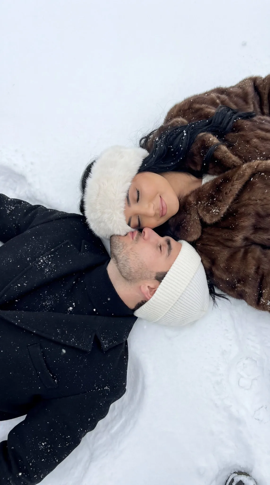

# Özge Döner — by @astronomerozge1

[← Back to Examples from X](../../EXAMPLES.md) · Category: Photography · Model: `Nano Banana`

<a href="https://x.com/astronomerozge1/status/2008595862771892704"></a>

Original post: **[@astronomerozge1 on X](https://x.com/astronomerozge1/status/2008595862771892704)** · Creator: [Özge Döner](https://x.com/astronomerozge1)

## Prompt

```text
{
  "generation_request": {
    "meta_data": {
      "tool": "NanoBanana Pro",
      "task_type": "photorealistic_single_image_editorial",
      "version": "v1.6_SUNSET_SEA_RED_DRESS_EDITORIAL",
      "priority": "highest"
    },
    "references": {
      "female_character_reference_image": "UPLOAD_FEMALE_REFERENCE (REQUIRED: IDENTITY + POSE INSPIRATION)"
    },
    "output_settings": {
      "aspect_ratio": "2:3",
      "orientation": "portrait",
      "resolution": "ultra_high_res",
      "render_style": "ultra_photoreal_high_fashion_editorial",
      "sharpness": "crisp_but_natural",
      "film_grain": "subtle_analog_film",
      "color_grade": "sunset_cinematic_warm_luxury"
    },
    "hard_constraints": [
      "ONE subject only (female).",
      "Perfect identity match to the uploaded reference (no face or body changes).",
      "No text, no logos, no watermarks.",
      "Perfect anatomy: hands, legs, proportions correct.",
      "Photoreal skin texture; no plastic or over-smoothed skin.",
      "No extra people, reflections, or background faces."
    ],
    "creative_prompt": {
      "scene_summary": "Ultra-photoreal high-fashion editorial portrait at the seaside during sunset. The same woman as the reference poses confidently on dark coastal rocks by the ocean. She wears a striking red halter-neck mini dress with soft flowing fabric and elegant movement. Her posture is poised and feminine, seated slightly angled toward the camera with legs bent naturally.\n\nHair: long, glossy dark waves worn down, softly shaped by the sea breeze. Makeup: luminous editorial glam—defined brows, subtle contour, glowing skin, soft smoky eyes, glossy nude-rose lips. Expression: confident, calm, magnetic, direct eye contact with the camera.\n\nBackground: open sea with gentle waves, distant horizon line, dramatic sunset sky in gradients of deep orange, pink, purple, and blue with scattered clouds. Lighting: cinematic dusk lighting with subtle fill flash on the subject to balance exposure; natural rim light from the sunset outlining hair and shoulders. Skin tones warm and realistic.\n\nCamera: 85mm editorial portrait lens look, shallow depth of field; subject tack sharp while ocean and clouds fall off softly. Mood: sensual, powerful, timeless, luxury fashion campaign energy—editorial, cinematic, and iconic."
    },
    "negative_prompt": [
      "any text, logo, watermark",
      "identity drift",
      "extra people",
      "distorted anatomy",
      "extra limbs or fingers",
      "cartoon, anime, CGI look",
      "plastic or over-smoothed skin",
      "harsh flash blowout",
      "low resolution",
      "overly saturated colors",
      "cheap styling or artificial fabric look"
    ]
  }
}
```

## Try it

Paste the prompt into **[vinano.ai](https://vinano.ai?utm_source=github&utm_medium=readme&utm_campaign=awesome-image-video-prompts-updating&utm_content=x-page-try)** to generate your own version.

> The image and prompt belong to [@astronomerozge1](https://x.com/astronomerozge1) and are shown here with credit for reference. Creators can ask for changes or removal by opening an issue.
